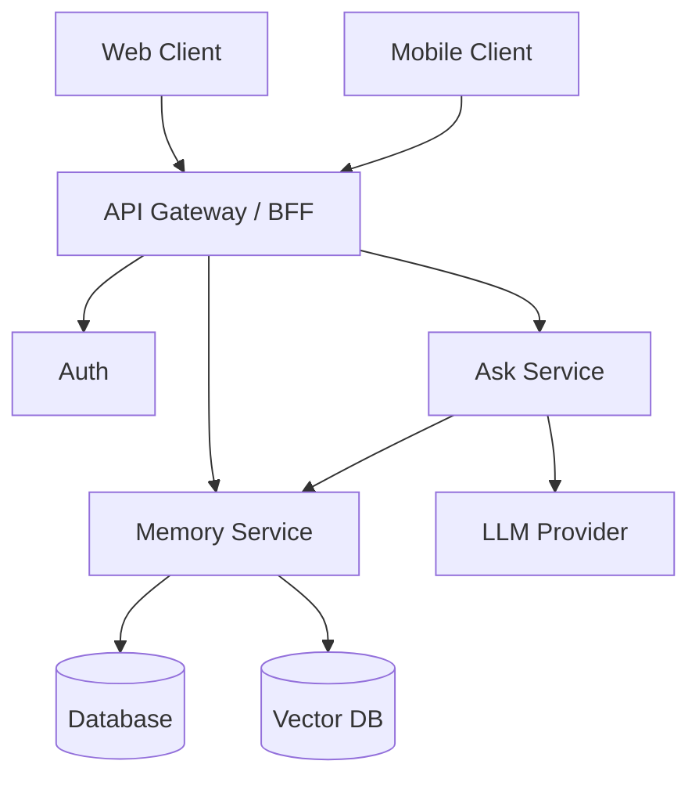
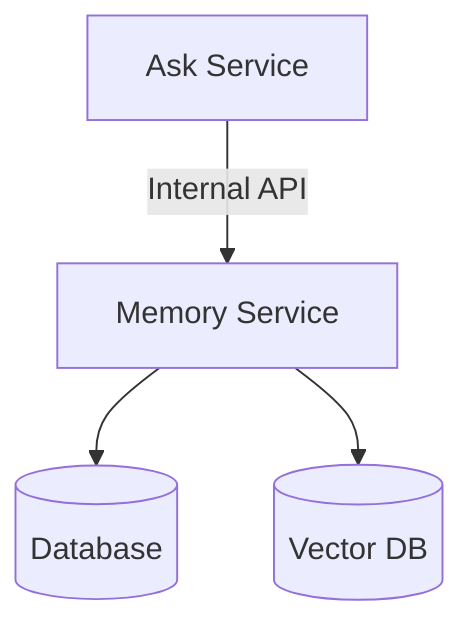

I had the product definition, user stories, and backlog—now it was time to design the system. I sketched a first architecture for Second-Memory—web and mobile through a BFF, Memory and Ask services, an LLM for recall—and the principles I wanted to carry through: a BFF so clients are not tied to internal layout, data ownership so databases stay inside the service that owns them, and DDD bounded contexts to separate the memory domain from AI interaction. Below is the diagram, then how each choice shows up in the design.

{/* truncate */}

The diagram itself is fairly simple, but there were several design principles behind it.

## 1. BFF for the clients

Both the web and mobile clients communicate through the API Gateway / BFF. I chose the **Backend for Frontend (BFF)** pattern so that the clients don't need to talk directly to internal services. The BFF provides a client-facing API while hiding the internal architecture, and gives me a place to handle authentication, routing, and client-specific requirements. Clients don't need to know whether a request is handled by the Memory Service, Ask Service, or something else—the internal architecture can evolve without every change surfacing in the clients.

## 2. Each service owns its data

One principle I wanted to follow was: **Don't share databases between services.** A service owns the data that belongs to its responsibility. In this architecture, the Memory Service owns both the database and vector database. If another service needs memory data, it doesn't connect directly to either store; it calls the Memory Service through an internal API.

For example:

This keeps data ownership clear and prevents other services from becoming coupled to the Memory Service's storage implementation. If the storage implementation changes later, the other service shouldn't need to know.

## 3. Separation of concerns

Each component has a specific responsibility. The BFF deals with client-facing communication. The Memory Service deals with memory. The Ask Service deals with the AI interaction. The LLM generates the response. The databases provide persistence. That separation makes the architecture easier to reason about and keeps AI-specific logic from spreading throughout the rest of the application.

## 4. DDD and bounded contexts

The split between Memory Service and Ask Service wasn't just about smaller services—I was thinking about different **domains and responsibilities**.

The Memory Service represents the memory domain:

- creating memories
- retrieving memories
- searching memories
- managing memory data

The Ask Service represents the AI interaction:

- receiving a question
- deciding what information is needed
- requesting relevant memories
- constructing context
- calling the LLM
- generating the answer

They are closely related, but they are not the same responsibility. **Bounded contexts** from Domain-Driven Design helped me think about the boundaries: the Ask Service uses the Memory Service, but it doesn't become responsible for managing memory itself.

## 5. Encapsulation and API contracts

The service boundary also creates an important form of encapsulation. The Ask Service doesn't need to know how the Memory Service stores or searches memories—only what it provides through its API. The Ask Service might ask for relevant memories without knowing whether the Memory Service uses PostgreSQL, pgvector, a different vector store, or something else later. The API becomes the contract between the services and keeps implementation details inside the service that owns them.

---

These principles gave me the initial structure of Second-Memory. It wasn't a complicated architecture, and that was intentional: clear boundaries without unnecessary complexity. With the boundaries in place, I could start looking at the individual technical decisions.
