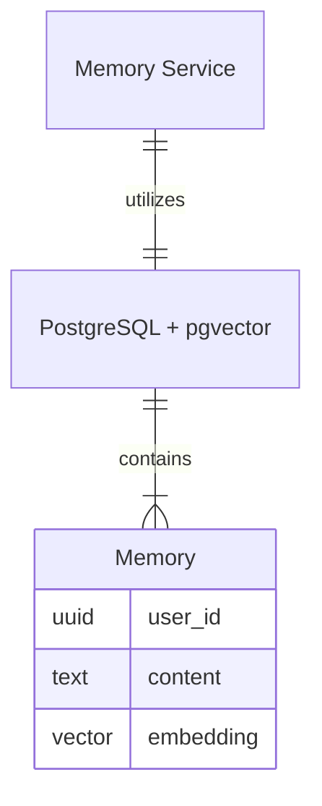

If a user later asks:

> “What did I write about performance problems?”

keyword search is not always enough. The memory might say:

> “The database becomes slow when thousands of users query it at the same time.”

There may be no exact match between the question and the memory. Second-Memory uses **semantic search**—embeddings and similarity—and for V1 I kept that in **PostgreSQL + pgvector** inside the Memory Service instead of adding separate vector infrastructure. Below: text to vectors, why pgvector for now, and the path from question to LLM context.

{/* truncate */}

## 1. From text to vectors

I can convert a piece of text into an **embedding**—a vector representation of its meaning. For example:

```text
"The database becomes slow when thousands of users query it at the same time."
         ↓
[Embedding model]
         ↓
[0.021, -0.183, ...]
```

The actual vector has many dimensions, so individual numbers are not meaningful on their own. What matters is the relationship between vectors: texts with similar meanings tend to sit closer together. So when a user asks a question, I can:

1. Question
2. Embedding
3. Vector similarity search
4. Relevant memories

This gives Second-Memory a way to retrieve memories based on **meaning**, rather than just matching words.

## 2. Why pgvector?

Once I decided to use embeddings, I needed somewhere to store and search them. I considered:

|  | pgvector | Pinecone |
| --- | --- | --- |
| Vector search | Yes | Yes |
| Relational data | Yes | No |
| Existing PostgreSQL | Yes | No |
| Separate infrastructure | No | Yes |
| Operational complexity | Lower | Higher |
| Good fit for V1 | Yes | Yes |

I chose **pgvector**. The main reason was not that pgvector is necessarily better than Pinecone—it was that Second-Memory already had a natural home for vectors: **the Memory Service's database.** With pgvector, I could keep each memory and its embedding together.



That kept the architecture simple.

## 3. Why not introduce a vector database?

A dedicated vector database could make sense at larger scale, but it also adds another system to operate and another boundary to manage. For V1 I did not see enough benefit to justify that complexity. The Memory Service could own:

- memory data
- embeddings
- vector search

all within the same data boundary. That also reinforced one of the architectural principles from the previous post:

> **The service that owns the data should own access to it.**

The Ask Service does not need to know whether semantic search uses pgvector, Pinecone, or something else; it asks the Memory Service for relevant memories.

## 4. What this gives me

With pgvector, the basic retrieval flow becomes:

```text
User question
      ↓
Generate query embedding
      ↓
Memory Service
      ↓
pgvector similarity search
      ↓
Relevant memories
      ↓
Ask Service
      ↓
     LLM
```

This is the first important piece of the AI architecture. The LLM does not need everything the user has ever written; the system retrieves memories most relevant to the current question and uses those as context.

## The decision

For Second-Memory V1, I chose:

**PostgreSQL + pgvector**

because it gave me semantic search without introducing another database. It was a pragmatic choice:

- vector search
- relational data
- one data boundary
- less infrastructure
- simpler development
