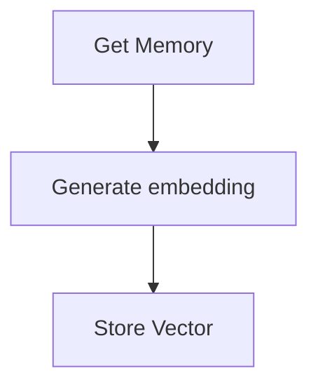
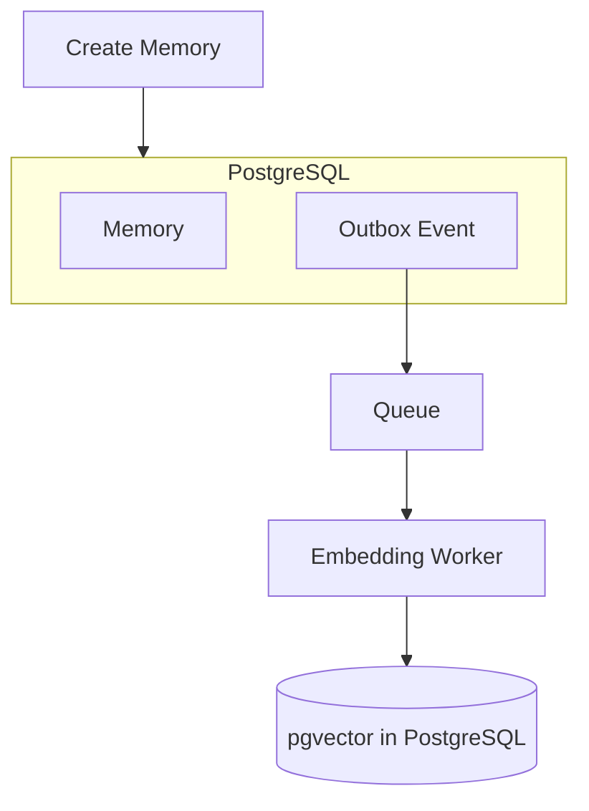

The previous post covered why I chose pgvector for semantic search. The next question was **when should a memory be embedded?** At first it looks simple—create memory, generate embedding, save embedding—but that ties memory creation to the embedding provider. If the provider is slow or unavailable, saving a memory can fail or stall. I separated those concerns with the **outbox pattern**, a **queue**, and an **embedding worker** so the API stays fast and durable while vectors catch up asynchronously. Below: each component, eventual consistency, failure handling, and the full flow.

{/* truncate */}

At first, it might seem simple:

```text
Create memory
     ▼
Generate embedding
     ▼
Save embedding
```

But this makes memory creation dependent on the embedding process. If the embedding provider is slow or unavailable, creating a memory could also fail or become slow. I wanted to separate these two operations. The architecture became:

```text
Memory Service
      ▼
 PostgreSQL
      ▼
 Outbox Table
      ▼
 Queue / Job Runner
      ▼
 Embedding Worker
      ▼
 pgvector
```

## 1. The Outbox Pattern

When a user creates a memory, the Memory Service writes the memory and an outbox event in the same database transaction. For example:

```text
Transaction
┌─────────────────────────────┐
│ INSERT memory               │
│ INSERT outbox event         │
└─────────────────────────────┘
```

The important part is that they succeed or fail together.

Without that, you can hit a failure mode that is easy to miss and painful to debug: **the memory is saved, but the embedding event is lost.** The API returns success; the user believes the entry is stored; later, semantic search never finds it because the vector was never queued. Nothing in the happy path tells you the pipeline broke halfway.

The outbox avoids that split outcome. It gives me a durable record of work that still needs to happen in the same commit as the memory. It is not the queue itself—it is a reliable bridge between the database transaction and asynchronous processing.

## 2. The Queue / Job Runner

A separate process reads pending outbox events and puts jobs onto a queue.

```text
Outbox
   ▼
Queue
   ▼
Embedding Worker
```

This gives the embedding process some useful properties:

- asynchronous processing
- retries
- independent scaling
- failure isolation
- no need to block the memory API

The user can save a memory without waiting for the embedding provider.

## 3. The Embedding Worker

The embedding worker has one main responsibility: **turn memory text into an embedding and store it in pgvector.**



This keeps embedding-specific logic out of the Memory Service's synchronous request path and gives me a place to evolve the embedding pipeline later. For example, I could change:

- embedding models
- chunking strategy
- retry behaviour
- batch processing
- embedding dimensions

without changing the API used to create a memory.

## 4. Why asynchronous?

There is an important consequence of this design: **a newly created memory may not be immediately searchable.** There can be a small delay between:

```text
Memory created
     │ asynchronous processing
     ▼
Embedding created
     ▼
Memory available for semantic search
```

I accepted this trade-off. For Second-Memory, immediate persistence is more important than making the embedding operation part of the user's request. This is essentially **eventual consistency** between the memory record and its vector representation.

## 5. Failure becomes easier to handle

The asynchronous design also changes how failures work. If the embedding provider temporarily fails:

```text
Memory
  ▼
Outbox
  ▼
Queue
  ▼
Embedding Worker - X -> Retry
```

The memory itself has already been safely stored. The embedding job can be retried without asking the user to submit the memory again. That separation was important to me.

## The decision

The final flow became:



Each part has a different responsibility:

| Component | Responsibility |
| --- | --- |
| Memory Service | Store the memory |
| Outbox | Reliably record the event |
| Queue | Deliver asynchronous work |
| Embedding Worker | Generate embeddings |
| pgvector | Store and search vectors |

This added some complexity compared with simply generating the embedding inside the API request. But it gave me something more important: **memory creation is no longer tightly coupled to the availability of the embedding pipeline.** That was the trade-off I wanted.
