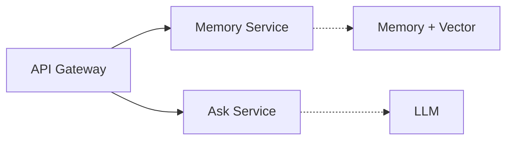
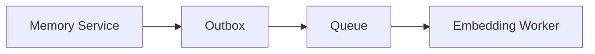
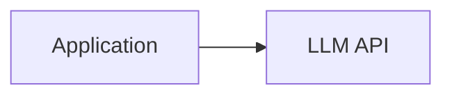

The initial architecture had three main backend responsibilities:

- Memory Service
- Ask Service
- Embedding Worker

Behind that sat a simpler option: **why not one backend?** A monolith would be easier for a small app—and probably enough for V1. I still split Second-Memory into services for **clear boundaries** between memory and AI interaction, **room to practice** queues, workers, retrieval, and LLM integration as a real system, and **independent scaling** when load differs across capture, embed, and ask. Below: how those boundaries map to services, what a monolith would have saved, and the trade-off I accepted.

{/* truncate */}

## 1. Clear boundaries

Memory and Ask have different responsibilities.

The **Memory Service** owns the memory domain:

- create and manage memories
- persist memory data
- generate/retrieve relevant memories
- manage embeddings

The **Ask Service** owns the AI interaction:

- receive questions
- retrieve relevant context
- construct prompts
- call the LLM
- return the answer

They work together, but they represent different responsibilities. I wanted those boundaries at the service level—not only as modules inside one application.

The Embedding Worker is separated for a different reason: embedding generation is asynchronous work and does not need to be part of the request that creates a memory.

The boundaries follow the responsibilities and execution models of the system.

## 2. A system for learning AI engineering

Second-Memory is also a project for exploring how AI systems are built. I did not want the architecture to stop at:

The system gave me an opportunity to work with several patterns that are common in production AI systems:

- asynchronous processing
- queues
- workers
- embeddings
- vector search
- retrieval
- service-to-service communication
- LLM integration

Using separate services makes these boundaries explicit and gives me a way to experiment with each part independently. The goal is not microservices for their own sake—the architecture should help me learn and validate how these pieces work together as a real system.

## 3. Production readiness and scaling

I also wanted to design Second-Memory as something that could eventually grow into a production system. The different components have different scaling characteristics. If memory creation increases, I may need more Memory Service instances. If embedding jobs increase, I can scale the workers independently. If AI requests become the bottleneck, the Ask Service can scale independently.

That does not mean I need to scale everything independently today. It means the architecture does not force unrelated workloads into the same deployment unit.

## What about a monolith?

A monolith would still be a reasonable choice for Second-Memory. It would have:

- less infrastructure
- simpler deployment
- simpler local development
- fewer service-to-service calls
- less operational overhead

So why accept the additional complexity? Because my goal was not only to build the simplest V1. I wanted a system with **clear boundaries that could evolve toward production scale**, while giving me a practical environment to explore AI system architecture. The trade-off was intentional.

> **I chose microservices not because a monolith couldn't work, but because the boundaries, asynchronous workloads, learning goals, and potential scaling characteristics made the additional complexity worthwhile.**
