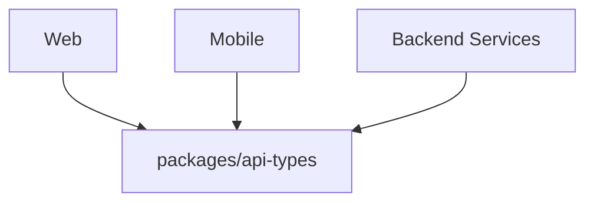
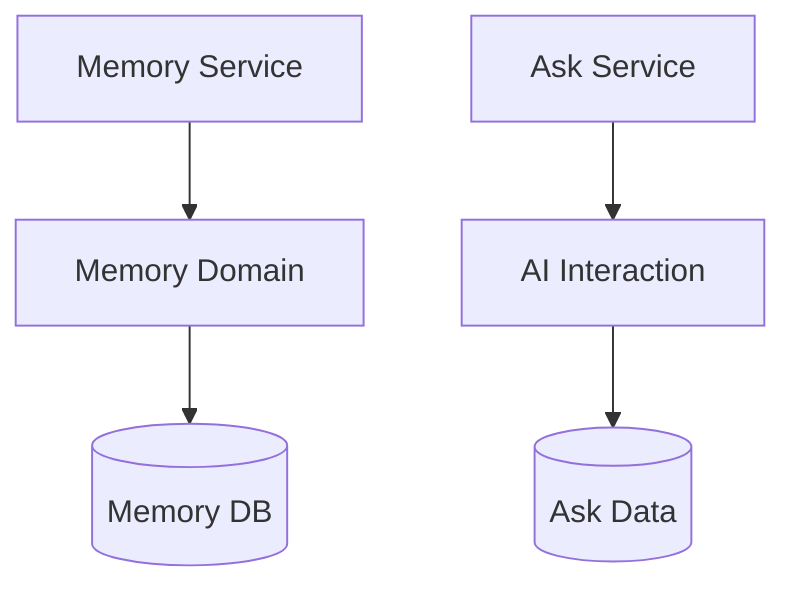
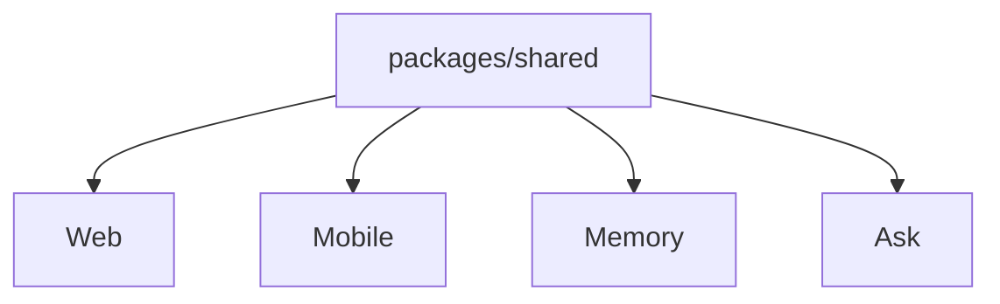
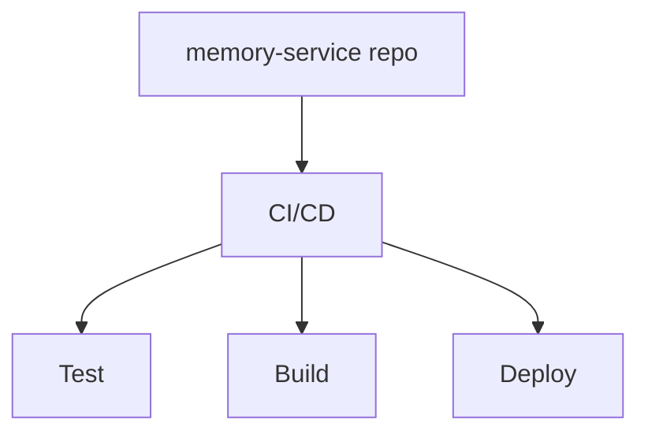

After choosing microservices, the next question was **how should I organise the codebase?** Second-Memory has several deployable apps and services—web, mobile, memory, ask, embedding worker—plus shared packages, all one product. I chose a **monorepo** because as a solo developer I valued easy shared API types, cross-project changes, and one local checkout more than repository-level isolation. Below: monorepo vs polyrepo on everyday tasks, when each fits, what deserves a shared package, CI/CD trade-offs, and the build-tooling question that followed.

{/* truncate */}

Second-Memory's layout looks like this:

```text
apps/
  web/
  mobile/

services/
  memory-service/
  ask-service/
  embedding-worker/

packages/
  api-types/
  ui-components/
```

They are independently deployable, but they are all part of the same product.

## Monorepo vs Polyrepo

There is no universally better choice. The trade-offs become clearer when looking at common development tasks:

| Area                      | Monorepo                                                       | Polyrepo                                                  |
| ------------------------- | -------------------------------------------------------------- | --------------------------------------------------------- |
| **Share code**            | **Easy** — reusable code can live in shared packages           | Harder — publish packages or duplicate code               |
| **Share types**           | **Easy** — TypeScript types can be shared directly             | Harder — types need separate versioning                   |
| **Cross-project changes** | **Easy** — related changes can be made in one PR               | Harder — changes may require multiple PRs                 |
| **Dependency management** | **Easy** — dependencies can be managed consistently            | More complex — each repo manages its own dependencies     |
| **Local development**     | **Easy** — one repository contains the whole system            | More setup — multiple repositories need to be configured  |
| **CI/CD**                 | More complex — need to detect affected projects                | **Easy** — each repository naturally has its own pipeline |
| **Service isolation**     | Harder — boundaries need to be enforced within the repository  | **Easy** — repositories provide natural isolation         |
| **Access control**        | Harder — repository access generally covers the whole codebase | **Easy** — permissions can be managed per repository      |
| **Independent releases**  | Possible — CI/CD can deploy projects independently             | **Easy** — each repository has its own release lifecycle  |

Neither approach is inherently better. For Second-Memory, I valued **easy development across the whole system** more than repository-level isolation.

## When to Choose Which

A monorepo can be a good fit when:

- **Small team or solo developer** — one repository is easier to manage than several.
- **Projects share contracts or code** — changes can be made and tested together.
- **Cross-project changes are common** — one PR can update multiple applications or services.
- **The whole system is closely related** — one repository makes it easier to understand and work across the product.

Polyrepo can be a better fit when:

- **Large or independent teams** need clear ownership boundaries.
- **Strong repository isolation** is important.
- **Projects have different release cycles**.
- **Access control** needs to differ between projects.

For Second-Memory, being a **sole developer** was one of the main reasons I chose a monorepo. Managing several repositories would add overhead without giving me much benefit. I didn't need repository-level ownership boundaries between teams—I wanted to make it easy to work across the web app, mobile app, backend services, and shared contracts.

## What Should Be Shared?

A monorepo makes sharing easy, but **easy to share doesn't mean everything should be shared**. I wanted to keep the shared surface area small.

| Shared Part                | Used By              | Why Share It?                     |
| -------------------------- | -------------------- | --------------------------------- |
| **API types**              | Web, Mobile, Backend | Keep API contracts consistent     |
| **Web-specific code**      | Web                  | Keep it inside `apps/web`         |
| **Mobile-specific code**   | Mobile               | Keep it inside `apps/mobile`      |
| **Service domain logic**   | Individual service   | Keep ownership within the service |
| **Service implementation** | Individual service   | Preserve service boundaries       |

So instead of creating shared packages for everything, I only create a package when there is a genuine reason to share something. For example:

```text
apps/
  web/
  mobile/
services/
  memory-service/
  ask-service/
  embedding-worker/
packages/
  api-types/
  ui-components/
```

The API types are shared because they represent a contract between different parts of the system. But a Web-only component stays in `apps/web`, a Mobile-only utility stays in `apps/mobile`, and Memory Service domain logic stays inside `memory-service`.

### Share the contract, not the ownership

The fact that services live in the same repository doesn't mean they should share their internal implementation. The API contract can be shared:



while the services remain independently owned:



> **Share contracts where it makes sense, but don't share service ownership.**

## Keeping the Shared Surface Small

There is another practical reason for limiting shared code. The more projects depend on a shared package, the larger the potential impact of a change. For example:



A change to `shared` may require all projects to be tested. But a change here:


only affects Web. That has implications for both **CI/CD** and **application dependencies**. I don't want a large `shared` package that contains unrelated functionality used by almost every project—I prefer small, focused shared packages with clear reasons for existing.

## The CI/CD Trade-off

CI/CD is one area where polyrepo can be simpler. With polyrepo, a change to `memory-service` naturally belongs to the `memory-service` repository.



In a monorepo, multiple deployable units live in the same repository. A change to:

```text
services/memory-service/
```

shouldn't necessarily rebuild and deploy everything. The pipeline needs to understand:

- what changed
- what depends on it
- what needs to be tested
- what needs to be built
- what needs to be deployed

This becomes particularly important when shared packages are involved. A change to `ui-components` may affect only web and mobile projects, while a change isolated to `services/embedding-worker/` should ideally affect only the relevant pipeline. The repository structure itself is simple, but the build and deployment system needs to become more intelligent as the project grows.

## Why Monorepo for Second-Memory?

The main benefits for me were:

- **Easy** sharing of API types
- **Easy** cross-project changes
- **Easy** local development
- **Easy** dependency management
- **Easy** visibility of the whole product
- Less overhead for a **solo developer**

The trade-offs were:

- **More complex** CI/CD
- More tooling needed as the repository grows
- Less repository-level isolation
- The need to carefully control shared dependencies

For Second-Memory, I was willing to accept these trade-offs. The goal wasn't to share as much code as possible—it was to get the convenience of a monorepo while keeping **ownership and dependencies clear**.

That led to the next question:

**How do I manage builds, dependencies, task execution, and caching across all these projects?**
