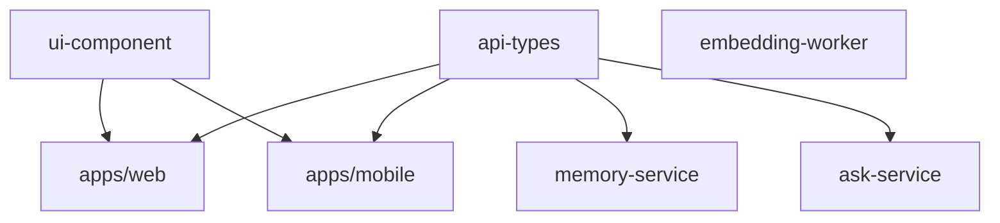
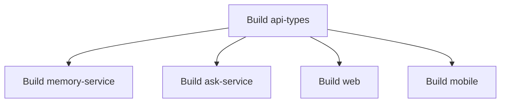

The monorepo post ended with a practical question: **how do I manage builds, dependencies, task execution, and caching across all these projects?** Second-Memory needs shared API types between web, mobile, and backend, but not a tangle of manual `file:` paths and one-off root scripts. **Workspaces** define packages and link local dependencies from the root; as the graph grows, **task orchestration** decides what to run and in what order. I added **Turborepo** for task graphs, affected tasks, and caching without adopting a full Nx-style platform. Below: why monorepo and workspaces fit this product, two problems filters alone do not solve, and how Turborepo compares to workspaces-only and Nx.

{/* truncate */}

## Why a Monorepo?

> A monorepo is a single repository containing multiple distinct projects, with well-defined relationships. — [Monorepo Explained](https://monorepo.tools)

A monorepo makes sense when multiple projects have meaningful relationships:

- **Shared libraries and utilities** — reuse common code across projects.
- **Shared contracts** — keep API types consistent between producers and consumers.
- **Cross-project changes** — update related projects in a single change.
- **Shared tooling and rules** — maintain consistent development practices.

If projects have no meaningful relationships, separate repositories may be simpler.

For Second-Memory, Web, Mobile, and Backend need to agree on API contracts. Sharing TypeScript API types helps keep those contracts consistent. Web uses React/Next.js, while Mobile uses React Native/Expo, so their UI implementations remain separate—code is shared only where it genuinely works across both platforms. Keeping related projects together makes coordinating changes and managing shared contracts easier.

How do we manage their packages and dependencies?

## Why Workspaces?

> Workspaces are a set of features in the npm CLI that provide support for managing multiple packages from a local file system within a single top-level root package. — [npm Workspaces](https://docs.npmjs.com/cli/v8/using-npm/workspaces)

A monorepo can work without workspaces. Each project can have its own `package.json` and manage dependencies independently. For example:

```text
second-memory/
├── apps/
│   ├── web/
│   └── mobile/
├── services/
│   ├── memory-service/
│   ├── ask-service/
│   └── embedding-worker/
└── packages/
    ├── api-types/
    └── ui-component/
```

Suppose both Web and Memory Service depend on `api-types`. Without workspaces, each project needs to manage its dependencies and local references separately. A project might reference the shared package using a local file dependency:

```json
{
  "dependencies": {
    "@second-memory/api-types": "file:../../packages/api-types"
  }
}
```

The relative path depends on the consuming project's location. Dependencies must be installed and managed in each project, and keeping local references and updates consistent requires additional care.

With workspaces, the root configuration defines which directories contain packages. For example, with pnpm:

**`pnpm-workspace.yaml`**

```yaml
packages:
  - "apps/*"
  - "services/*"
  - "packages/*"
```

Each package declares its own dependencies in its `package.json`. For example, Web can depend on the shared API types package:

**`apps/web/package.json`**

```json
{
  "dependencies": {
    "@second-memory/api-types": "workspace:*"
  }
}
```

The shared package identifies itself in its own `package.json`:

**`packages/api-types/package.json`**

```json
{
  "name": "@second-memory/api-types",
  "version": "1.0.0"
}
```

The `workspace:*` protocol explicitly tells pnpm to use the local workspace package. Dependencies can then be installed from the repository root:

```bash
pnpm install
```

pnpm recognises the workspace packages and links local dependencies, making it easier to manage relationships between projects.

### Without Workspaces vs With Workspaces

| Area                         | Without workspaces                            | With workspaces                                         |
| ---------------------------- | --------------------------------------------- | ------------------------------------------------------- |
| Install dependencies         | Install separately in each project            | Install from the root                                   |
| Reference shared packages    | Configure local file dependencies or links    | Declare dependencies between workspace packages         |
| Manage package relationships | Maintain references across projects           | Define participating packages in the root configuration |
| Develop shared packages      | Manage local references and updates carefully | Work with linked local packages                         |
| Run builds and tests         | Run scripts manually or maintain root scripts | Still requires scripts or task orchestration            |

A workspace reduces manual package and dependency management. It provides a way to define packages and their local dependencies within the monorepo. However, managing packages is only part of the problem. As the number of projects and dependencies grows, coordinating builds, tests, and other tasks becomes another challenge.

## Why Task Orchestration?

With only a few projects, running build and test commands manually may be enough. As the repository grows, two problems become more noticeable.

### Problem 1: Running Only the Necessary Tasks

The dependencies in Second-Memory look like this:



Suppose I change `packages/ui-component`. Web and Mobile depend on it, but Memory Service, Ask Service, and Embedding Worker do not. Ideally, I want to run checks for the affected projects without wasting time checking unrelated services.

With workspaces alone, I can run individual commands using package filters:

```bash
pnpm --filter web test
pnpm --filter mobile test
```

But I still need to know which projects depend on the changed package and decide which commands to run. As the dependency graph grows, maintaining this selection manually becomes more difficult. Task orchestration can automate the selection of relevant tasks based on package relationships, configured task dependencies, and changes.

### Problem 2: Managing Dependencies Between Tasks

Some tasks need to run before others. For example, if a service consumes a shared package's compiled output, that package needs to be built before the service. I could maintain a script to enforce the order:

```json
{
  "scripts": {
    "build:memory": "pnpm --filter api-types build && pnpm --filter memory-service build"
  }
}
```

This works for a simple case, but the scripts become harder to maintain as more packages and task dependencies are added. Ideally, I want to define task relationships once and let a tool determine the correct execution order.

## How Task Orchestration Helps

Task orchestration adds a layer above workspace package management. It coordinates tasks such as builds, tests, and linting across packages.

### Task Graph

A task graph describes dependencies between tasks and helps determine their execution order. For example, if `api-types` must be built before its consumers:



The graph should reflect the actual build requirements. If consumers compile the shared package's source directly, a separate build step may not be necessary.

Turborepo uses the workspace package dependency graph together with configured task dependencies to determine execution order. The package relationships provide the foundation; task configuration defines how tasks depend on one another.

### Affected Tasks

When a package changes, Turborepo can use Git change information and the dependency graph to select affected packages and their relevant tasks.

- **Change `api-types`:** Web, Mobile, Memory Service, and Ask Service may be affected.
- **Change `ui-component`:** Web and Mobile may be affected.
- **Change `embedding-worker`:** Its checks can run independently of the other projects.

This reduces the need to maintain manual build and test sequences as the repository grows. The result depends on the configured task graph, available Git change information, and the tasks defined by each package.

### Additional Benefits

| Technique          | Benefit                                                          |
| ------------------ | ---------------------------------------------------------------- |
| Caching            | Reuse valid task results instead of repeating unchanged work     |
| Parallel execution | Run independent tasks concurrently while respecting dependencies |
| Remote caching     | Share cached results across developers and CI when configured    |

These capabilities can improve development and CI performance, although the primary goal is to manage task relationships and execution more reliably.

## Comparing the Approaches

| Capability                             | Workspaces alone                     | Turborepo                        | Nx                          |
| -------------------------------------- | ------------------------------------ | -------------------------------- | --------------------------- |
| Manage packages and local dependencies | Yes                                  | Uses a workspace package manager | Yes                         |
| Run scripts across packages            | Yes, using scripts and filters       | Yes                              | Yes                         |
| Coordinate task dependencies           | Manual scripts or additional tooling | Built-in task orchestration      | Built-in task orchestration |
| Identify affected tasks                | Manual selection or custom tooling   | Supported                        | Supported                   |
| Cache task results                     | Requires additional tooling          | Built-in                         | Built-in                    |
| Run independent tasks in parallel      | Manual or script-based               | Built-in                         | Built-in                    |
| Broader project tooling and plugins    | Limited to package management        | Task-focused                     | More extensive options      |

Workspaces alone can be sufficient for a small repository with simple build and test requirements. Turborepo and Nx become useful when coordinating tasks across project dependencies requires more automation.

Both provide task orchestration, affected-task capabilities, caching, and parallel execution. Nx offers a broader set of project tooling and plugins, while Turborepo focuses more directly on task orchestration. For Second-Memory, I wanted the task orchestration capabilities without needing a broader project-management system.
