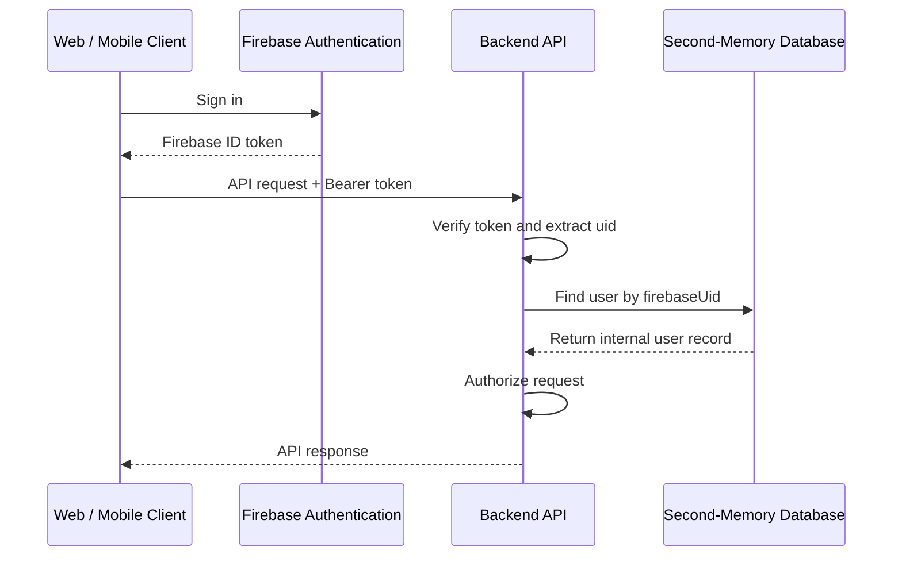

Authentication is essential to Second-Memory, but it is not the core product—capture and recall are. Building login, sessions, and social OAuth in-house would add security and ongoing operations without advancing that goal, and another password is friction most users do not need. I chose **Firebase Authentication** with social sign-in preferred, an internal user table keyed by `firebaseUid`, and backend verification on every API call. Below: build vs buy, what in-house auth actually involves, the end-to-end flow, and why authorization still lives in my services.

{/* truncate */}

## Build vs. Buy

I considered two approaches: building authentication in-house or using an existing service.

| Consideration       | In-house authentication                                  | Firebase Authentication                                                                                  |
| ------------------- | -------------------------------------------------------- | -------------------------------------------------------------------------------------------------------- |
| Initial development | Build authentication flows and supporting infrastructure | Integrate an existing service                                                                            |
| Security            | Implement and maintain security controls                 | Firebase manages core authentication infrastructure; the application still has security responsibilities |
| Maintenance         | Handle security updates and operational issues           | Google maintains the service                                                                             |
| User experience     | Users may need another account and password              | Users can sign in with a supported existing identity                                                     |
| Engineering cost    | More development and ongoing maintenance                 | Less implementation and maintenance work                                                                 |

For a project like Second-Memory, building authentication from scratch would mean taking on additional complexity without providing much differentiation.

## What Does In-House Authentication Involve?

Building authentication is more than verifying a username and password. It means taking responsibility for several areas.

**1. Security**

- Store passwords using an appropriate password-hashing algorithm.
- Protect against brute-force attacks and credential stuffing.
- Implement secure session management, including expiration and revocation.
- Protect account recovery and verification flows against account takeover.
- Manage secrets, security logging, monitoring, and incident response.

**2. Account lifecycle**

- Registration and email verification
- Login and logout
- Account recovery and password resets
- Account deletion and related data cleanup
- Session revocation and suspicious-login handling

**3. Social login integration**

Supporting social login involves integrating with external identity providers and handling their authentication flows. Standards such as OpenID Connect (OIDC) and OAuth 2.0 are commonly involved, depending on the provider and flow. The application must also handle identity mapping, account linking where appropriate, and the relationship between an external identity and its own user records.

**4. Ongoing operations**

Authentication requires continued attention after launch. Security vulnerabilities emerge, dependencies need updates, and authentication flows must be tested as the application evolves. The effort doesn't end when login starts working.

## The Decision

I don't have specific authentication requirements that justify building and maintaining my own system. I'll use Firebase Authentication and make social login the preferred way to sign in. This avoids asking users to create another password and lets me rely on an established authentication service.

There may be usage costs and some provider dependency, but building authentication in-house also has costs in development time, maintenance, and security responsibilities. For Second-Memory, Firebase Authentication is a practical choice because it meets my needs without requiring me to build and operate an authentication system myself.

However, using a third-party authentication service doesn't eliminate application security responsibilities. Second-Memory still needs to validate identities correctly, enforce authorization in the backend, and ensure users can access only their own data.

## How Authentication Works in Second-Memory

Second-Memory has web and mobile clients, plus backend services. Both clients use Firebase Authentication, while the backend verifies each request and maps the Firebase identity to an internal user record.

### The authentication flow

The flow has six steps:

1. **Sign in:** The client signs in with Firebase Authentication and obtains a Firebase ID token.
2. **Call the API:** The client sends the token in the `Authorization: Bearer <token>` header.
3. **Verify the token:** The backend verifies the token using the Firebase Admin SDK. It must not trust a token simply because it can decode it.
4. **Extract the Firebase UID:** After verification, the backend reads the user's Firebase UID from the token.
5. **Resolve the internal user:** The backend looks up the user record using `firebaseUid`.
6. **Authorize the request:** The backend uses the internal user ID to enforce access controls and scope data operations to that user.

### Why maintain our own user table?

Firebase provides authentication, but Second-Memory still needs its own application-level user record. For example:

| id        | firebaseUid        |
| --------- | ------------------ |
| `usr_123` | `firebase-uid-abc` |
| `usr_456` | `firebase-uid-xyz` |

The `id` is Second-Memory's internal user ID, while `firebaseUid` links the record to Firebase Authentication. The `firebaseUid` column should have a unique constraint.

This separation has a few advantages:

- **Domain independence:** Memories and other application entities can reference Second-Memory's internal user ID.
- **Consistent authorization:** Backend services can use the same internal identity when checking data access.
- **Flexibility:** If the authentication provider changes in the future, the application's domain model doesn't need to use provider-specific identifiers everywhere.

The backend must still enforce authorization on every relevant request. A valid Firebase token proves the caller's authenticated identity; it does not automatically grant access to a particular memory or resource. The backend should derive identity from the verified token, not trust a user ID supplied by the client.

### How this fits the client and backend stack

The same authentication principle applies across the different parts of Second-Memory, although their implementations differ.

- **Next.js web app:** Configure Firebase for the web client, implement sign-in, and attach the ID token to API requests.
- **Expo mobile app:** Configure Firebase Authentication for React Native, handle session persistence, and attach the ID token to API requests.
- **Backend services:** Use the Firebase Admin SDK to verify ID tokens, resolve the internal user, and enforce authorization.

The important distinction is that the clients obtain tokens, but the backend is responsible for verifying them and deciding what the authenticated user is allowed to access.

## Conclusion

For Second-Memory, authentication is necessary infrastructure, not a feature I need to reinvent. Firebase Authentication reduces the amount of authentication code I need to build and maintain. Keeping an internal user record also lets Second-Memory separate external identity verification from application-level identity and authorization.

The goal isn't to eliminate security responsibilities. It's to use an established service for authentication while keeping control of the application's own data and access rules.
