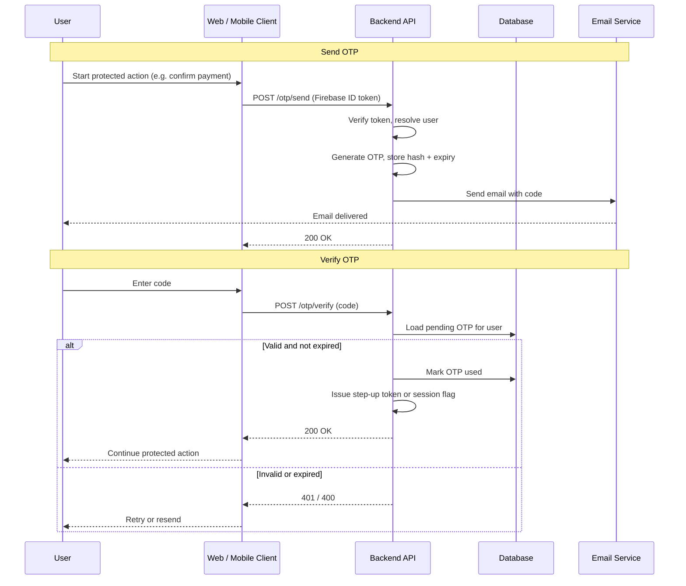

We already use **Firebase Authentication** for primary login—ID tokens on the client, verified on the backend with the Admin SDK. That answers **who the user is**. It does not always prove they **still control the account** at the moment they confirm a payment, change payout details, or export sensitive data. **Step-up verification**—email **one-time passwords (OTP)** or magic links—closes that gap.

Step-up does not replace Firebase. Users keep sending the same ID token; sensitive routes additionally require recent proof via email. Because Firebase is already in the stack, [Firebase email-link sign-in](https://firebase.google.com/docs/auth/web/email-link-auth) was the obvious first idea. This post compares that shortcut with a **custom OTP** service layered on the same auth.

{/* truncate */}

## Primary login vs step-up

| Layer | Responsibility |
| --- | --- |
| Firebase (existing) | Sign-in, session, ID token, `firebaseUid` → internal user |
| Step-up (new) | Short-lived proof before payments, billing changes, exports, etc. |

The backend pattern stays familiar: verify the Firebase token first, resolve the user, then—for protected actions—check a step-up credential or reject with `403` and prompt for verification.

## When step-up matters

Typical triggers:

- Confirming or changing **payment** methods and billing settings
- Approving a **transfer or purchase** above a threshold
- **Exporting** or deleting account-held data
- Any action where a stolen session should not be enough

For those flows the API usually needs two answers:

1. Is the caller authenticated (session or ID token)?
2. Have they **recently** verified via a channel you control (email OTP or equivalent)?

The shortcut we tried first: trigger Firebase email-link sign-in, then read **last sign-in time** and **`sign_in_provider`** from the ID token or Admin SDK user record. If the provider indicated email link and sign-in fell within a window (for example 15 minutes), allow the action—no new OTP tables or send endpoints.

That only works—**if** the metadata matches what the user actually did.

## Options considered

| | Firebase email-link step-up | Custom OTP |
| --- | --- | --- |
| Implementation | Reuse Firebase send/link APIs + session metadata | `POST /otp/send`, `POST /otp/verify`, DB, email |
| User steps | Open email, tap link (device matters) | Open email, type or paste code (any device) |
| Proof on backend | Last login time + `sign_in_provider` | OTP record + short-lived step-up token |
| Ops burden | Low if metadata is trustworthy | You own security, delivery, and abuse controls |

## Security concerns

### Firebase email-link step-up

- **Weak backend proof** — If you gate on `sign_in_provider` and last login, a normal password sign-in can look like step-up; policy mistakes can skip re-verification entirely.
- **Link as bearer secret** — Anyone with the magic link can consume it; forwarded email or a shared inbox completes the flow.
- **Full sign-in side effects** — Email link is real authentication, not a scoped step-up token—sessions refresh, audit trails mix login with “confirm payment,” and revocation semantics are coarser.
- **Device binding** — Links opened on the wrong device can strand or confuse users; support pressure rises before security does.

### Custom OTP

- **Your threat model** — Brute force, credential stuffing on `/otp/verify`, and OTP spraying via `/otp/send` need rate limits, lockouts, and monitoring you implement and operate.
- **Storage and logs** — Plaintext OTPs in the database or logs are a common failure mode; hash at rest and never log codes.
- **Email channel** — Same mailbox risks as a magic link; a short numeric code can be easier to phish or shoulder-surf if UX is careless.
- **Step-up token lifecycle** — Issue tight TTL, bind to user (and optionally device/session), and reject replay; otherwise a verified OTP window becomes a long-lived bypass.

## Option 1: Firebase sign-in via email link

Firebase documents this flow as passwordless email-link authentication on the web—see [Authenticate with Firebase Using Email Link](https://firebase.google.com/docs/auth/web/email-link-auth).

### Why it is attractive

- **Reuse existing Firebase auth** — same project, Admin SDK, and email patterns as primary login.
- **No OTP product to build** — Firebase generates and validates the link; you focus on when to require step-up.
- **Deep links** — mobile clients can resume in-app after the user taps the link.
- **Continue URLs / query params** — return the user to the payment or settings screen that triggered verification.

### Where it breaks down

- **Cross-device UX** — magic links often complete on the device that opened the email. Starting checkout on phone and opening mail on a laptop breaks the flow unless you invest in handoff.
- **Session edge cases** — expired links, stale tabs, and multiple active sessions need explicit testing.
- **POC friction** — a quick spike often surfaces integration details that are not obvious from the docs; Firebase handles sign-in, not necessarily your step-up policy.
- **The blocker: `sign_in_provider`** — after email-link sign-in, Firebase reports `sign_in_provider` as **`password`**, not a distinct email-link provider. You cannot tell “just completed email link step-up” from “signed in with email/password” using provider alone. **Last login time + provider is an unreliable gate** before a payment or similar action.

Unless you add another durable signal (custom claims from a Cloud Function on link completion, a dedicated step-up flag, etc.), Option 1 does not give the backend clean, auditable step-up proof.

## Option 2: Custom OTP

Firebase stays primary auth. Step-up is a **narrow API** beside it: send a code to the email on the Firebase user (or your internal profile), verify it, issue a **short-lived step-up token** (or a server-side “verified until” timestamp keyed by user id).

### Pros

- **Explicit proof** — the backend knows an OTP was sent, verified, consumed, and when.
- **UX control** — codes work when email is read on another device; resend, cooldown, and validation UI are yours.
- **One pattern, many gates** — the same flow can guard payments, billing changes, and exports.
- **No Firebase metadata quirks** — step-up does not depend on `sign_in_provider` semantics.

### Cons

- **Build and maintain** — generation, hashing, expiry, single-use, templates, monitoring (see security notes above).

### Flow

In words:

1. **Send** — Client calls `/otp/send` with the usual Firebase ID token. Backend verifies it, resolves the user, stores a **hashed** OTP with expiry, sends email. Never store plaintext codes.
2. **Verify** — Client submits the code. Backend checks hash, expiry, and single-use, marks the OTP consumed, returns a **step-up credential** (JWT claim, cookie, or server-side “verified until”).
3. **Protected APIs** — Require a fresh step-up credential within the policy window in addition to normal auth—for example before submitting a charge or updating a payout account.

## Implementation notes (custom OTP)

- **Hash OTPs** at rest; short TTL (for example 10–15 minutes); one active send per user with resend cooldown.
- **Rate limit** send and verify; cap attempts per OTP before invalidation.
- **Email** — state the action (“Confirm payment”, “Update billing”) so users know why they received a code.
- **Audit** — log send/verify outcomes without logging the code.
- **Clients** — one backend contract; web and mobile differ only in how they collect the code.

## Takeaway

We wanted step-up without ripping out Firebase. Email-link step-up is the natural fit, but **`sign_in_provider` reporting `password` breaks the simple “provider + last login” rule**. Patching that with custom claims or Cloud Functions adds moving parts—and still blurs sign-in with step-up.

**Custom OTP** is more code, but it sits cleanly **on top of** existing Firebase auth: same ID token at the edge, plus an explicit step-up proof the API can enforce before payments and other sensitive work.

A practical rollout: ship a thin vertical slice (send + verify + one protected endpoint, such as payment confirmation) behind a feature flag, and load-test rate limits before widening coverage.
