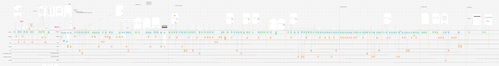
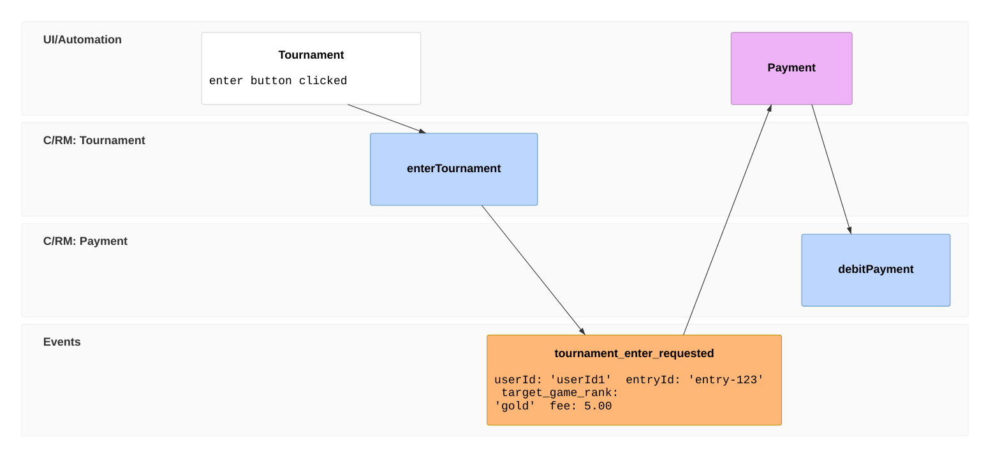
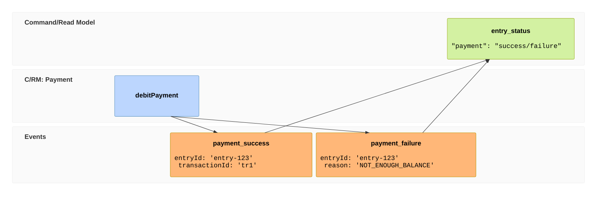
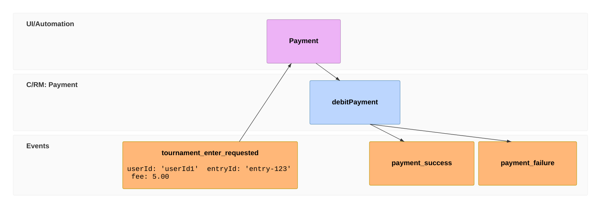
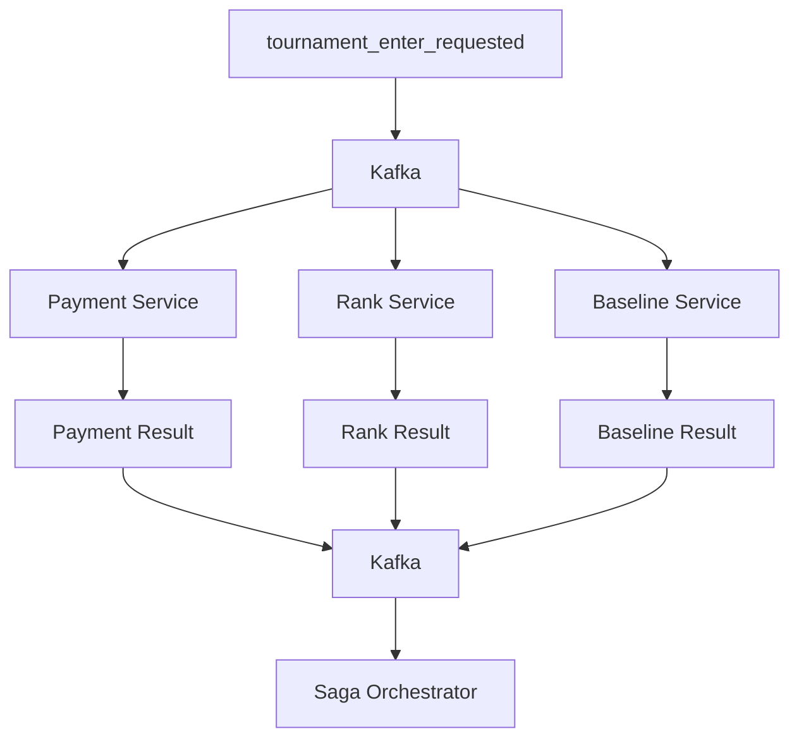

We Event-Modeled a **multi-team tournament product** to keep delivery **scalable**: domain squads own slices on one board, and later features can often **subscribe to events already on the timeline** instead of rewiring core flows.

This **case study** follows three beats:

1. **Why Event Modeling** — product-wide board, Conway-aligned teams, event contracts.
2. **Event Modeling in practice** — the [**seven steps**](https://eventmodeling.org/posts/what-is-event-modeling/#seven-steps) on the **tournament entry** process (diagrams, abbreviated tickets).
3. **Running tournament entry** — **Saga** and **CQRS**-style read paths as the runtime shape that matches the model.

We modeled the **whole tournament**; this post **zooms into tournament entry** for depth on fan-out, orchestration, and compensation. Simplified example; reflects how we modeled, sliced, and shipped the work.

{/* truncate */}

## 1. Why Event Modeling

The tournament product had **many processes** and **domain-based teams** in parallel—for example **Tournament (Team A)** and **Payment (Team B)**. We needed one **shared** picture of workflows, not a separate integration design per feature.

Event Modeling gave us a **scalable** way to deliver:

- **Parallel ownership** — swimlanes aligned to Conway’s law; each team implements workflow steps from the same board.
- **Stable contracts** — event payloads define what you consume and publish; backlog items snap to adjacent steps.
- **Easy extension** — a later feature (for example notifications) can often be a new consumer on an event the model already defines, without changing tournament entry’s core design.

We modeled the **full tournament** on one board. This article **goes deep on tournament entry** because that slice best shows **Saga** and **CQRS** at runtime in §3—not because Event Modeling is only for tournament entry. Tournament entry is **async and multi-service** on the board; **§3** shows how we ran it.

Using the seven-step workshop **only** for a tiny feature would be over-engineering; at **product** scope it paid off.

## 2. Event Modeling: tournament entry

**Part I** — how we modeled **tournament entry** on the product board (other tournament processes used the same seven steps; we do not repeat them here).

**Tournament entry scenario:** a player enters an online tournament from the app. One user action must **charge an entry fee**, **verify game rank**, and **record a baseline** before play starts—across Team A/B services and external APIs.

The PO had PRD and wireframes for the **full tournament**; we aligned the model to them and elaborated **tournament entry** below using the [**seven steps**](https://eventmodeling.org/posts/what-is-event-modeling/#seven-steps).

At product scale the board was much larger than the diagrams in this post. The export below is the **whole-tournament** model we worked from (company security limits how crisp we can share it—expect a wide, low-resolution image). Everything from step 1 onward is **tournament entry** only.



### Step 1 — Brainstorm

We collected **state-changing** outcomes only—not read-only actions like “user viewed status.” Participants named happy paths, failures, and compensation. Not every idea stayed: **if there was no place to put an event** yet (no owner, no **when X → publish Y** hook), we **ignored it** until a later step gave it a home. Each kept name is the **Y** you **publish** when a step’s outcome is known. The list is **unordered**; nothing goes on the timeline until step 2.

For tournament entry, the brainstorm list included:

- `tournament_enter_requested`
- `payment_success` / `payment_failure`
- `game_rank_verified` / `game_rank_verification_failed`
- `baseline_captured` / `baseline_capture_failed`
- `payment_refunded`
- `tournament_entry_confirmed` / `tournament_entry_rejected`

### Step 2 — The plot

Put the brainstorm list on a **timeline** and check the story holds. Commands, wireframes, swimlanes, and payloads come in later steps.

```mermaid
eventmodeling
  tf 01 evt tournament_enter_requested [[tournament_enter_requested]]
  tf 02 evt payment_success [[payment_success]]
  tf 03 evt payment_failure [[payment_failure]]
  tf 04 evt game_rank_verified [[game_rank_verified]]
  tf 05 evt game_rank_verification_failed [[game_rank_verification_failed]]
  tf 06 evt baseline_captured [[baseline_captured]]
  tf 07 evt baseline_capture_failed [[baseline_capture_failed]]
  tf 08 evt payment_refunded [[payment_refunded]]
  tf 09 evt tournament_entry_confirmed [[tournament_entry_confirmed]]
  tf 10 evt tournament_entry_rejected [[tournament_entry_rejected]]
```



### Step 3 — Storyboard

The PO’s wireframes sit at the top of the board: screens, fields, and what the user triggers. That anchors commands and read models to real UI—who clicks what, and what they see while the workflow runs. We did not redraw UX in the workshop; we aligned the model to wireframes already in the PRD package.

### Step 4 — Identify inputs

We tied each timeline step to **what triggers it** and **what data flows in**: UI actions, commands, and event payloads upstream handlers consume.

A **command** is an intention to do work—it can be rejected or fail before anything is recorded as an event. Examples on our board:

- `Tournament.enterTournament` (user action in the UI)
- `Payment.debitPayment` (often triggered after `tournament_enter_requested` arrives)
- `GameRank.checkGameRank`
- `Baseline.captureBaseline`

For example, `Payment.debitPayment` expresses what we want the payment service to attempt.



### Step 5 — Identify outputs

We filled in **published event payloads** and **read models** (views)—the fields other swimlanes and the UI need after each step completes.

Outcome events from the payment command, for example:

- `payment_success` — fee, transaction id, entry id
- `payment_failure` — entry id and failure status

Read models such as `entry_status` aggregate those outcomes for queries and the frontend.



### Step 6 — Swimlanes (Conway’s law)

**Swimlanes** assign commands, events, and views to owning components so teams can own autonomous parts. The timeline explains *what happens*; swimlanes clarify *who implements it*.

| Component | Typical owning team | Responsibility |
|---|---|---|
| Web application | Tournament (A) / frontend | Submit tournament entry request and display status |
| Tournament Entry API | Tournament (A) | Create a pending tournament entry |
| Payment Service | Payment (B) | Process payment and refunds |
| Rank Service | Tournament (A) or game integration | Verify player eligibility |
| Baseline Service | Tournament (A) or game integration | Capture game statistics |
| Saga Orchestrator | Tournament (A) or platform | Track operation results and coordinate the overall outcome |

Unlike a sequential workflow, payment processing, rank verification, and baselining can run independently once `tournament_enter_requested` exists. Final confirmation still depends on all three results—the orchestrator combines them in §3.

[](https://mermaid.live/edit#pako:eNqNVF1v2jAU_SuWX_pC09gOheahUttV3aSJTlP3MlKlJrmkWYnDHAeNRf3vc-w4QPnQeADfc-85vvfYpsFJmQIOMaxAqEKvF7nIIoGQmiOfoDpHT2UtBS90GjVIf4NEs1qpUqBkkSdvkKL3SDgGRUmRblE8Q9jEro4hWZStmlzHleKqrtD59XXLb9ASRKqbaGVtcYBgpZDqRWIjGkv4XUOldAMddTo9XvP83DdJfLRMJPrG12YoQw5cjpgBupyXwixXXeAqqOlmacG4qpMEqkrv_QFpN7QEtkOY83xRS9CETUVw2A29lflh6OVXVYqXBkW4k4lwqINuq4tOM8JbR0HtlA_aje9cvO2OSe2YLuklr5C8ucjV2EEzjcZSw_EKZD7Ptd3T6T7YD0PZQVrCVV4KM_1BhZ38RuyIM9Q6Q7ed6RWtN66xCyu54w2z3tzyqr3usOsNs964pJfwpdLmuthVWXdmHRp3Ve1oe1g_DmMHSRtXjmQ2Akf8YNYPtu2H07J2uF627ED_87GepVzxUw-waYvqCuSXNERndkHOWtC0alCzOieUGVxxmYGK-0PTBVm5SE1uDhCioef7kTBnZnb_-OCak-pasuJJe6VMVsm2m30x9xhPikng2lMNTx6f4vvJ44-Hz_Htzdebyd19K4oHOJN5ikMlaxjgAmTB2xAb0QirVyi6Q0i51LfTcpZc_CzLwtFkWWevOJzzRaWjeqnbhE85zyQvelTqP0aQd2UtFA7ppdHAYYP_6IheeSQIrhgdjwkdD0kwwGsckrHvjZhPhwGjARld-ux9gP-abYnHfOIHo7FPrkYkYMPh-z_dZAQP)

_(click the image above to see it in a full screen in mermaid live)_

### Step 7 — Elaborate scenarios (Task creation)

Each workflow step on the board became concrete backlog work: handle a command, publish an event, subscribe and react, or update a read model. Specs are **Given–When–Then** (or Given–Then for views), tied to **one** command or read model on the board. In the backlog, we wrote **detailed** tickets—schema fields, topic names, error cases, and dependencies copied from the model. The snippet below is an **abbreviated** PAY-1 in that format, not the full ticket we shipped.



#### Example ticket (abbreviated): PAY-1 — `Payment.debitPayment` on `tournament_enter_requested`

**Scenario: successful debit**

- **Given** a consumed `tournament_enter_requested` with valid `entryId`, `userId`, and `fee`, and no successful debit already recorded for that `entryId`
- **When** the Payment service runs `Payment.debitPayment`
- **Then** `payment_success` is published (including `transactionId`)

**Scenario: debit fails**

- **Given** a consumed `tournament_enter_requested` with valid `entryId`, `userId`, and `fee`
- **When** the Payment service runs `Payment.debitPayment` and the provider rejects the debit (for example insufficient balance)
- **Then** `payment_failure` is published for that `entryId` (including `reason`)

**Scenario: idempotent retry**

- **Given** a successful debit was already recorded for `entryId`
- **When** the same `tournament_enter_requested` is delivered again
- **Then** the service does not double-charge and does not publish a second `payment_success` for the same logical debit

PAY-1 is one slice among many on the board. **§3** shows how tournament entry runs at runtime.

## 3. Tournament entry at runtime: Saga and CQRS

**Part II** — implement what the board drew for tournament entry: async fan-out, **Saga** orchestration, and **CQRS**-style separation between accepting the request and querying status.

The swimlanes already showed parallel work after one initiating event; the failure tree already implied refunds and rejection. Architecture did not replace the model—it implemented it.

### Why tournament entry needs async orchestration

In a monolith, fee, rank check, and baseline might share one database **transaction**. Split into microservices—and external payment/game APIs—that pattern breaks: **partial failure** (payment succeeds, rank fails), **no rollback** on external charges, **long or fragile** sync HTTP chains from the Tournament Entry API, and **unclear recovery** if the caller crashes mid-flow.

| Operation | Owning area | Typical failure |
|---|---|---|
| Payment | Team B | Insufficient balance, provider error |
| Rank verification | Team A / game API | Rank mismatch, API unavailable |
| Baselining | Team A / game API | Timeout, missing data |

Those constraints are why **tournament entry** maps to **Saga + events** in this section.

### Fan-out processing with Kafka

The Tournament Entry API creates a pending tournament entry and publishes a single event—the same `tournament_enter_requested` the Payment task subscribes to. Multiple services consume it independently.



This is a **fan-out/fan-in pattern**.

### Fan-out

A single event is distributed to multiple independent consumers.

Each service handles its own responsibility:

- The Payment Service processes the entry fee.
- The Rank Service verifies player eligibility.
- The Baseline Service captures the player's initial statistics.

Each service uses its own Kafka consumer group so that it receives the event independently.

The operations don't need to complete in a particular order.

### Fan-in

After processing, each service publishes a result event.

For example:

```typescript
interface payment_success {
  entryId: string;
  transactionId: string;
}

interface game_rank_verified {
  entryId: string;
  rank: string;
}

interface baseline_captured {
  entryId: string;
  baselineId: string;
}
```

These are simplified event payloads. A production implementation would typically include event identifiers, timestamps, correlation information, and schema versions.

The Saga orchestrator consumes the result events and updates the status of each operation.

Kafka provides asynchronous communication, but it doesn't determine whether the tournament entry should be confirmed or rejected.

That decision belongs to the Saga orchestrator.

### Saga orchestration with status aggregation

The Saga Pattern coordinates a distributed business transaction through multiple local operations and compensating actions.

There are two common approaches:

- **Choreography:** Services react to each other's events without a central workflow coordinator.
- **Orchestration:** A central coordinator maintains workflow state and determines the overall outcome, including any required compensation.

We'll use orchestration, but rather than executing every step sequentially, the orchestrator aggregates the results of independently running operations.

### Tracking individual operation statuses

Each operation has its own status.

A simplified Saga state might look like this:

```typescript
type StepStatus = 'PENDING' | 'SUCCESS' | 'FAILED';

type EntryStatus =
  | 'PENDING'
  | 'CONFIRMED'
  | 'COMPENSATING'
  | 'REJECTED'
  | 'REQUIRES_ATTENTION';

interface TournamentEntrySaga {
  entryId: string;

  payment: StepStatus;
  rankVerification: StepStatus;
  baselining: StepStatus;

  refundStatus?: StepStatus;

  status: EntryStatus;
}
```

When the tournament entry is created, all operations start as `PENDING`.

```json
{
  "entryId": "entry-123",
  "payment": "PENDING",
  "rankVerification": "PENDING",
  "baselining": "PENDING",
  "status": "PENDING"
}
```

As events arrive, the orchestrator updates the corresponding statuses.

For example, after receiving `payment_success`:

```json
{
  "entryId": "entry-123",
  "payment": "SUCCESS",
  "rankVerification": "PENDING",
  "baselining": "PENDING",
  "status": "PENDING"
}
```

When all operations succeed:

```json
{
  "entryId": "entry-123",
  "payment": "SUCCESS",
  "rankVerification": "SUCCESS",
  "baselining": "SUCCESS",
  "status": "CONFIRMED"
}
```

The main status is determined by the combined results rather than by any single service.

### Evaluating the overall status

A simplified evaluation function might look like this:

```typescript
function evaluateEntryStatus(
  saga: TournamentEntrySaga,
): EntryStatus {
  const steps = [
    saga.payment,
    saga.rankVerification,
    saga.baselining,
  ];

  if (steps.every(status => status === 'SUCCESS')) {
    return 'CONFIRMED';
  }

  if (steps.includes('FAILED')) {
    if (saga.payment === 'SUCCESS') {
      if (saga.refundStatus === 'SUCCESS') {
        return 'REJECTED';
      }

      return 'COMPENSATING';
    }

    if (saga.payment === 'PENDING') {
      return 'PENDING';
    }

    return 'REJECTED';
  }

  return 'PENDING';
}
```

This illustrates the basic aggregation rules. A production implementation would also distinguish retryable technical failures from definitive business failures and handle refund initiation separately.

The important point is that **the orchestrator evaluates the overall state whenever an operation result arrives**.

It doesn't assume events will arrive in a particular order.

### Handling out-of-order events and compensation

Independent services can complete at different times.

Suppose rank verification fails before the Payment Service publishes its result.

The events might arrive in this order:

```text
1. game_rank_verification_failed
2. baseline_captured
3. payment_success
```

When the first event arrives, the orchestrator knows the tournament entry cannot be confirmed.

However, it doesn't yet know whether payment has succeeded.

It cannot simply reject the tournament entry and forget about the remaining operations.

When `payment_success` eventually arrives, the orchestrator must recognise that the tournament entry is already ineligible and initiate a refund.

This is why maintaining individual operation statuses is important.

### Compensating the payment

Once the orchestrator knows that a tournament entry has failed and payment succeeded, it requests a refund.

```text
game_rank_verification_failed
           |
           v
   Tournament entry cannot be confirmed
           |
           v
     payment_success
           |
           v
   Payment.refundPayment
           |
           v
      payment_refunded
           |
           v
   tournament_entry_rejected
```

The refund is not a database rollback.

It is a separate business transaction that compensates for the successful payment.

The orchestrator should wait for the refund result before considering the failed tournament entry fully resolved.

### What if the refund fails?

Compensating transactions can fail just like normal operations.

For example, the payment provider might be temporarily unavailable, or a refund request might time out.

In that situation, the orchestrator should retain enough state to retry the refund safely.

If automatic recovery is exhausted, the Saga may need to enter a state such as `REQUIRES_ATTENTION` for operational intervention.

The key principle is that **a failed business workflow must not silently leave a successful payment uncompensated**.

### Handling duplicate events

Kafka consumers can process the same message more than once.

For example, if a consumer processes an event but crashes before committing its offset, the event may be delivered again.

Without idempotency, duplicate processing could trigger repeated operations or refunds.

A common approach is to assign each event a unique identifier and track processed events.

```typescript
interface DomainEvent<T> {
  eventId: string;
  entryId: string;
  type: string;
  payload: T;
}
```

When handling an event, the orchestrator can check whether it has already been processed.

State transitions should also be protected against concurrent updates. A duplicate event must not cause a completed Saga to return to a pending state or issue another refund.

For payment and refund operations, stable idempotency keys are especially important.

For example:

```typescript
const refundIdempotencyKey =
  `entry:${entryId}:refund:${transactionId}`;
```

All retries of the same logical refund should use the same key.

### Persisting state reliably

The Saga's state needs to survive service restarts.

The orchestrator must be able to recover the current operation statuses and determine whether compensation is still required.

Another important consideration is the consistency between database updates and Kafka message publication.

For example, if the orchestrator records that compensation is required but crashes before publishing the refund command, the system needs a recovery mechanism.

The Transactional Outbox Pattern is one possible solution. It stores the state change and outgoing message in the same database transaction, then publishes the message asynchronously.

This is an optional implementation technique rather than an inherent part of the Saga Pattern, but it addresses an important reliability concern.

### CQRS: exposing tournament entry status to the frontend

The backend workflow is asynchronous, but the user still needs immediate feedback.

Rather than keeping the HTTP request open until payment, rank verification, and baselining finish, the API can create a pending tournament entry and return immediately.

```http
POST /tournament-entries

HTTP/1.1 201 Created
Content-Type: application/json

{
  "entryId": "entry-123",
  "status": "PENDING"
}
```

The frontend then polls tournament entry status.

```http
GET /tournament-entries/entry-123
```

While the Saga is running:

```json
{
  "entryId": "entry-123",
  "status": "PENDING"
}
```

Once all operations succeed:

```json
{
  "entryId": "entry-123",
  "status": "CONFIRMED"
}
```

If a required operation fails and any necessary compensation completes:

```json
{
  "entryId": "entry-123",
  "status": "REJECTED"
}
```

This is an example of eventual consistency.

The initial request creates a tournament entry, but confirmation happens later when the distributed workflow reaches a final outcome.

This is the **read model** from step 5 in concrete form: **commands and events** advance the workflow; **`entry_status`** (and the GET API) are what the UI polls while the Saga runs. We did not split write and read databases for every field—the important decision is **request acceptance vs business completion**.

`201 Created` is appropriate when a tournament entry resource has been created in a pending state.

## 4. Lessons learned

**Part III** — reflections from the case study above.

### The model, tasks, and architecture should stay aligned

When swimlanes match service ownership and tasks match publish/subscribe boundaries, the Kafka topology and orchestrator responsibilities largely fall out of the board. Payment's task diagram and the fan-out diagram describe the same edges with different detail. When the model and the code drift apart, the cost shows up in integration tests and cross-team PRs—not in the tutorial diagrams.

### Event Modeling makes failure scenarios visible

A successful workflow is usually easy to describe.

The difficult part is identifying what happens when one operation fails while others are still running.

Event Modeling helps expose these scenarios before implementation, making it easier to define compensation requirements and state transitions.

### Independent operations require careful coordination

Fan-out processing allows multiple services to work independently, potentially reducing overall processing time.

However, it also means result events can arrive in any order.

The orchestrator must combine operation statuses without assuming a particular completion sequence.

### Saga orchestration is more than sequencing commands

An orchestrator doesn't necessarily need to execute every operation one after another.

In this example, its primary responsibilities are maintaining workflow state, evaluating the combined results, and coordinating compensation.

The Saga's correctness depends on how these responsibilities are implemented, not simply on having a central service.

### Compensation is a business operation

A refund is not equivalent to rolling back a database transaction.

It can fail, require retries, and need operational intervention.

Compensating transactions deserve the same attention to reliability and idempotency as the original operations.

### Kafka doesn't guarantee business consistency

Kafka provides reliable event transport and supports asynchronous processing, but it doesn't automatically solve duplicate processing, distributed transactions, or business-level consistency.

Those concerns must be addressed in the application design.

### Eventual consistency is also a frontend concern

The frontend must understand that an accepted request isn't necessarily a completed business operation.

Pending states, status polling, meaningful error messages, and recovery from long-running operations are all part of the user experience.

## Conclusion

We Event-Modeled the **tournament product** to **scale delivery** across domain teams; new features can often attach to events already on the board without replatforming tournament entry.

**§2:** the seven steps on **tournament entry** (board, swimlanes, PAY-1). **§3:** the same slice as **Saga** and **CQRS**-style reads at runtime.

Reliable tournament entry still needs persisted saga state, idempotent handlers, and a frontend that treats acceptance and confirmation as different states.

**The most important design choice is not the happy path. It is what must happen when only part of the workflow succeeds—and making sure the board, the backlog, and the runtime all tell that story the same way.**