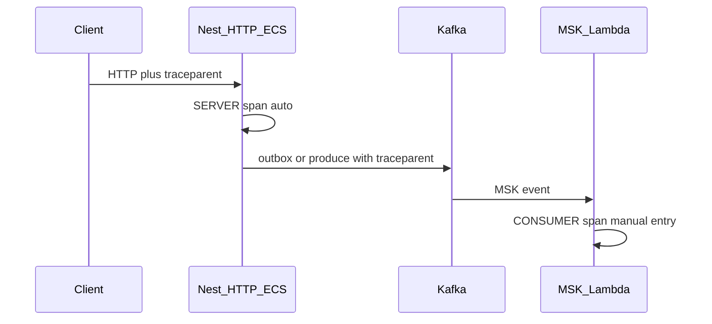
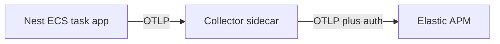
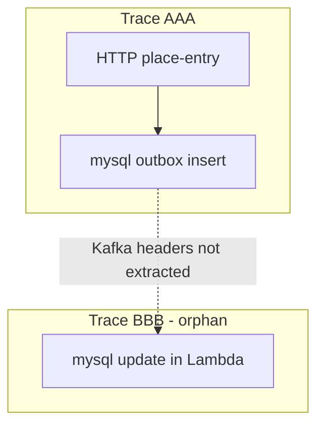
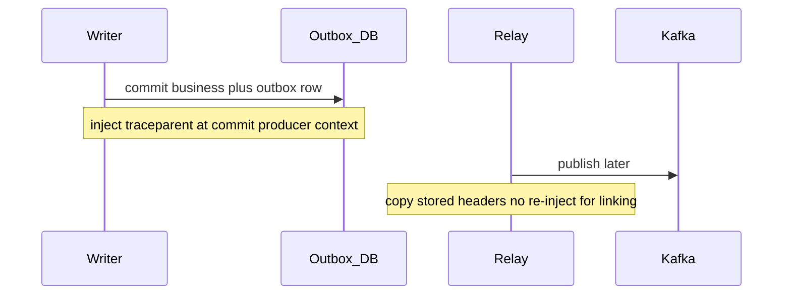
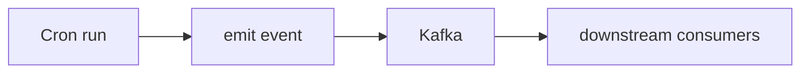
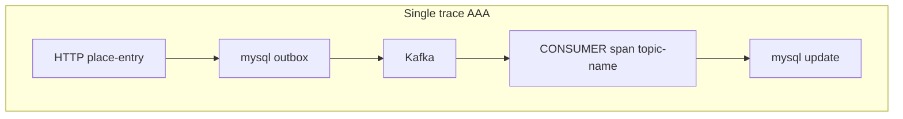

We already had **distributed logging**—enough to grep across services when something broke. What we did not have was a **single picture of a request** as it crossed HTTP, Kafka, Lambdas, and long-running Node workers on PM2. **Tracing** was the next pillar; we chose **[OpenTelemetry](https://opentelemetry.io/)** so instrumentation stays **vendor-neutral** while we export spans to **Elastic APM** today and can change backends later without rewriting apps.

This post follows how we rolled it out: **Collector topology**, **auto-instrumentation on the happy path**, then **where auto stops** and **how we fix it** (`withTraceSpan` at entry points, **`propagation.inject`** on outbox commit)—not a full CDK or Dockerfile runbook.

{/* truncate */}

## 1. Observability and OpenTelemetry

**Observability** means you can answer *what is the system doing, and why?* Three signals work together:

| Pillar | Question it answers |
| --- | --- |
| **Logging** | What happened, when, where, and with what context? |
| **Tracing** | How did one logical operation flow through services and queues? |
| **Metrics** | How is the system behaving over time—and when should we alert? |

We added **traces first**; logs stayed as-is. Metrics and alert routing (Slack, on-call) are next on the same OTLP path.

Proprietary APM agents work until they do not. OpenTelemetry gives **shared APIs and OTLP export** so the same spans can feed Elastic, Jaeger, or Prometheus/Grafana. **TL;DR:** instrument once at the app; let a **Collector** handle batching, secrets, and vendor-specific export.

### Traces, spans, context, and W3C

A **trace** is the full story of one logical operation (for example “place tournament entry”) across every service it touches. A **span** is one unit of work—HTTP handler, DB query, Kafka consume.

**Context** ties spans together. Cross-service work uses a **carrier** (HTTP headers, Kafka/AMQ message headers, outbox JSON stored in MySQL/Mongo):

- **Extract** on inbound: read the carrier into the active OpenTelemetry context before starting spans.
- **Inject** on outbound: write the current span’s identifiers into the carrier.

We use **[W3C Trace Context](https://www.w3.org/TR/trace-context/)** (`OTEL_PROPAGATORS=tracecontext`). The `traceparent` header encodes `version-trace_id-parent_span_id-trace_flags` (for example `00-aed57677…-2f208df4…-00`). That is the same problem space as **correlation IDs**, but standardized so any OTEL-aware hop can continue the trace.

**Span names** should name a *class* of work, not one instance—`get_user` not `get_user/314159` ([spec guidance](https://github.com/open-telemetry/opentelemetry-specification/blob/main/specification/trace/api.md#span)).



### What the OpenTelemetry Collector does

The **SDK in your app** creates spans, attaches attributes, batches them, and sends **OTLP** (gRPC or HTTP) to an endpoint—usually on localhost.

The **[OpenTelemetry Collector](https://opentelemetry.io/docs/collector/)** is a separate process that:

| Stage | Role |
| --- | --- |
| **Receivers** | Accept OTLP (and other formats) from apps |
| **Processors** | Batch, sample, filter, enrich attributes, cap memory |
| **Exporters** | Forward to Elastic APM, logging, another OTLP endpoint, etc. |

**Why not export straight from the app to Elastic?** Collector config holds **API keys and endpoints**; you can change backends or sampling without redeploying every service; batching and retries reduce load on the app and on APM. Symfony, Nest on ECS, PM2 workers, and Lambda can all speak the same OTLP dialect to a Collector ([Elastic + OTEL](https://www.elastic.co/guide/en/apm/guide/current/open-telemetry.html)).

Apps still set **`OTEL_SERVICE_NAME`**, **`OTEL_PROPAGATORS=tracecontext`**, and **`OTEL_RESOURCE_ATTRIBUTES`** (including `deployment.environment.name=dev|qa|prod` so environments do not merge in APM).

### Sidecar, daemon, and Lambda layer (same Collector, different placement)

These are **deployment patterns**, not different products:

| Placement | Where we use it | App sends OTLP to |
| --- | --- | --- |
| **Sidecar** | **Nest HTTP on ECS** — second container in the **same task** | `http://127.0.0.1:4317` (or 4318) on the task network |
| **Daemon / agent** | **PM2 on EC2** — Kafka listeners, AMQ watchers, cron, legacy routers | Host-local Collector on `127.0.0.1` |
| **Layer** | **Lambda** — Collector bundled in the OTEL **layer** (not a separate sidecar container) | Localhost inside the execution environment; config often from S3 |



Until first-class OTEL logging is everywhere, we **enrich application logs** with trace and span IDs from the active span (Winston instrumentation with log shipping disabled worked for us).

## 2. Auto-instrumentation: the happy path

We enabled **[auto-instrumentations](https://www.npmjs.com/package/@opentelemetry/auto-instrumentations-node)** on Node via `NODE_OPTIONS` (`--require dotenv/config --require ./util/otel/register.js`) and PHP via the **OpenTelemetry extension** plus Composer auto packages on Symfony (HTTP, PDO, Guzzle). That gave quick wins: HTTP **SERVER** spans, many DB and outbound HTTP **CLIENT** spans, and sometimes **KafkaJS** produce/consume when the client runs **in the same process** with an active context.

**Stack snapshot** — same SDK ideas, different **process role** and **Collector placement**:

| Runtime | Where it runs | Collector | Auto covers (typical) |
| --- | --- | --- | --- |
| Symfony | EC2 / Docker | Agent or container on host | HTTP, SQL, Guzzle |
| Nest **HTTP API** | **ECS** | **Sidecar** in task | HTTP, many DB/HTTP clients |
| Nest / Node **Kafka listener**, **AMQ**, **cron**, legacy routers | **EC2 + PM2** | **Daemon** on host | Pure consumers: no HTTP entry; KafkaJS **sometimes**; not MSK Lambda |
| Lambda | AWS | **Layer** | HTTP varies; MSK needs manual extract |

**Happy path we validated first:** client → **Nest HTTP on ECS** → auto SERVER span → auto DB children → optional **direct** KafkaJS produce while the request span is still active (inject on broker headers). Export: app → **sidecar** → Elastic. Nest **Kafka listeners** on PM2 were often fine with auto-instrumentation; **MSK Lambda**, **outbox**, and **cron** were not (section 3).

Useful env vars (all Node roles): `OTEL_TRACES_EXPORTER=otlp`, `OTEL_EXPORTER_OTLP_ENDPOINT` (sidecar or host Collector), `OTEL_NODE_DISABLED_INSTRUMENTATIONS=fs` when needed, `OTEL_NODE_RESOURCE_DETECTORS=env,host,os` on bare EC2.

Symfony local dev used a **Collector container** on 4317/4318; production stayed “OTLP to nearest Collector.” Where auto stopped on Symfony we used PHP **`#[WithSpan]`**—same entry-span idea as the Node wrapper in section 3.

## 3. Where auto stops—and how we fix

**Auto-instrumentation** worked well for us—HTTP, SQL, and many clients inside a process. We kept it enabled everywhere.

Our stack also uses patterns auto does not cover end-to-end: **MSK-triggered Lambdas**, **transactional outbox**, and **cron jobs that emit events**. Three **boundaries**, two **mechanisms** (`withTraceSpan`, **`propagation.inject`**)—different **runtime shapes** from section 2’s in-process **KafkaJS** happy path, not a publish-versus-consume checklist.

### Where auto stops (and why)

#### 1. MSK-triggered Lambda (not KafkaJS consume)

**Why auto stops:** The handler receives **AWS event records** from MSK (headers as **binary** fields), not a KafkaJS **`EachMessagePayload`**. **`@opentelemetry/instrumentation-kafkajs`** never runs its consume hook—you may still model a **CONSUMER** span manually, but this is **not** a KafkaJS consumer for auto. Nothing auto-**extract**s `traceparent` from record headers or opens that entry span, so Lambda work often gets a **second trace id** while the producer/outbox half stays on the first—not assuming context from the message body alone.

One user action can look like **two traces** in APM:



#### 2. Transactional outbox

**Why auto stops:** The **writer** commits a **DB row** (header JSON + payload)—**not** a Kafka produce. There are no broker headers until the **relay** publishes; auto’s KafkaJS **produce** hook runs on direct **`send`**, not on outbox insert. Auto does not write OTEL fields into that header JSON. Without **`inject` at commit** (snapshot into the row, not “make outbox a KafkaJS producer”), there is nothing for relay to copy and nothing for consumers to **extract**.

If you **`inject` only at relay**, **`context.active()`** is the **relay process** (relay worker trace id), not the **producer-side trace** from commit—publish-time inject **mis-links**. If the row has **no** stored context and relay does not inject, Kafka may have **no** `traceparent` and consumers often start a **separate trace**. Relay delay (minutes or days) is fine; **`traceparent` is a snapshot**, not a live session.

With **direct** KafkaJS produce—the section 2 pattern—the **same instrumented Node process** produces and consumes while **active context in the writer** still matches the logical operation. No outbox hop, so auto can inject and extract on broker headers without a DB snapshot. When **MSK Lambda** is downstream of outbox, you typically need **inject on the writer** (here) **and** manual extract on Lambda (Stop 1).



#### 3. Cron job — simple entry that emits events

**Why auto stops:** There is no inbound **carrier** / `traceparent` (no browser, API Gateway, or Kafka consume on this process), so auto never opens an **entry** span. The script **emits events** that start a long downstream flow—you need a **root for this run** plus **inject on emit** so Kafka and consumers join that trace (see Fix 1 and Fix 2).



### What we had to do

1. **MSK Lambda** — MSK record headers are **binary** → build a string-key **carrier map** → **`propagation.extract`** → start a **CONSUMER** entry span (`withTraceSpan`).
2. **Transactional outbox** — Persist **W3C context** (`traceparent` via **`propagation.inject`**) on the outbox row **in the same transaction as the business write**, while **commit-time active context** still reflects the **producer-side trace**; relay **replays** that carrier onto Kafka headers (does not re-derive from relay **`context.active()`**).
3. **Cron (and similar entrypoints)** — No inbound `traceparent` → **`withTraceSpan`** opens a **new root trace** per run; **inject on emit** (Fix 2 below) when writing outbox or publishing.

### How we fix

#### Fix 1 — Wrapper function (`withTraceSpan`)

**Maps to:** MSK Lambda (Stop 1), cron and similar entrypoints (Stop 3); AMQ / API Gateway in the aside below.

Call sites pass **`{ name, options, carrier }`** when wrapping—the wrapper is intentionally small; each entry point chooses span name, **`SpanKind`** / attributes, and the W3C **carrier** map.

- **Inbound carrier (MSK, AMQ, API Gateway):** **`carrier`** = decoded headers (after binary → map for MSK). **`options`** sets **CONSUMER** or **SERVER** and messaging/HTTP attributes. **`propagation.extract(context.active(), carrier)`** runs before **`startSpan`**.
- **No inbound carrier (cron):** **`carrier: {}`** → **new root trace** per run; **`name`** = job module name. With that context active, **inject on emit** (Fix 2 for outbox rows, or direct publish).

On failure the span gets **`recordException`** and **`SpanStatusCode.ERROR`**. Auto-instrumentation inside the handler is unchanged. PHP **`#[WithSpan]`** on Symfony follows the same entry-span idea.

**Cron:**

```javascript
runJobWithOtelThenExit(
  withTraceSpan({ name: path.parse(__filename).name, carrier: {} })(run)
);
```

Linked trace after extract + entry span:



#### Trace vs tracer

- **Trace** — End-to-end journey; one **trace id** in `traceparent`.
- **Tracer** — `trace.getTracer(serviceName)` scopes spans to this **service** in APM; spans still join the same trace when parent context is passed to `startSpan`.
- **Span** — One unit of work; auto-instrumented children nest under the entry span when the handler runs inside `context.with(trace.setSpan(...))`.

MSK Lambda still chains **`createTransformMskRecord`** (binary headers → **`carrier`** map) via **`composeHandler`**. Middleware builds **`name`** (topic), **CONSUMER** **`options`**, and **`carrier`** per record, then applies **`withTraceSpan`**:

```typescript
composeHandler(
  createTransformMskRecord(event),
  withTraceSpanForMskRecord,
  createCaptureCorrelationIds(correlationIds),
  recordHandler
);

// withTraceSpanForMskRecord (per record): withTraceSpan({
//   name: topic,
//   options: { kind: SpanKind.CONSUMER, attributes: { 'messaging.destination': topic, ... } },
//   carrier: decodedHeaders,
// })(handler)
```

Lifecycle:

1. `propagation.extract(context.active(), carrier)` from props
2. `trace.getTracer(serviceName)`
3. `tracer.startSpan(name, options, activeContext)`
4. `context.with(trace.setSpan(activeContext, span), () => original(...args))`
5. On catch: `recordException`, `setStatus(ERROR)`, rethrow
6. `span.end()` in `finally`

```javascript
const { propagation, trace, context, SpanStatusCode } = require('@opentelemetry/api');
const { serviceName } = require('./config');

function withTraceSpan(props) {
  const { name, options, carrier } = props;

  return function wrap(original) {
    return async function wrapped(...args) {
      const activeContext = propagation.extract(context.active(), carrier);
      const tracer = trace.getTracer(serviceName);
      const span = tracer.startSpan(name, options, activeContext);

      try {
        const result = await context.with(trace.setSpan(activeContext, span), () => original(...args));
        return result;
      } catch (error) {
        span.recordException(error);
        span.setStatus({
          code: SpanStatusCode.ERROR,
          message: error.message,
        });
        throw error;
      } finally {
        span.end();
      }
    };
  };
}
```

#### Fix 2 — `propagation.inject` (outbox headers in DB)

**Maps to:** Transactional outbox (Stop 2).

Build the header object (Content-Type, message-*), then **`propagation.inject(context.active(), headers)`** in the **same DB transaction** as the business write ([manual propagation](https://opentelemetry.io/docs/languages/php/propagation/#manual-context-propagation)). **`traceparent`** is what inject adds for `tracecontext`; optional **`tracestate`** if non-empty. The JSON column is the **carrier**; relay copies it to **Kafka record headers**. **KafkaJS** listeners often **auto-extract**; **MSK Lambda** still needs Fix 1.

```javascript
const headers = {
  'Content-Type': 'application/json',
  'message-type': messageType,
  'message-schema-version': schemaVersion,
  'message-id': messageId,
};
propagation.inject(context.active(), headers);
// persist headers with outbox row in same transaction
```

Example stored with the outbox row:

```json
{
  "Content-Type": "application/json",
  "traceparent": "00-aed57677a060346c7850ad43d8a95dc6-2f208df453f6743a-00",
  "message-type": "tournament-entered",
  "message-schema-version": "1",
  "message-id": "c7bf7357-a32e-4b36-9f8c-1ea057220184"
}
```

After relay copies **`traceparent`** to record headers, an in-process **KafkaJS listener on PM2** can often **extract** with auto; **MSK-triggered Lambda** still needs Fix 1.

### Aside — other wrapper uses

- **AMQ:** Auto does not hook our queue manager like KafkaJS → **`withTraceSpan`** with queue name, **CONSUMER** **`options`**, message-header **`carrier`** on inbound; **`propagation.inject`** on outbound publish.
- **API Gateway Lambda:** **`withTraceSpan`** with **SERVER** **`options`**, span name `httpMethod` + resource path, **`carrier`** from API Gateway headers (including `x-correlation-id`).

```javascript
addItemToOutboundQueue(outboundQueue, item, customHeaders, ...) {
  const headers = { ...customHeaders };
  propagation.inject(context.active(), headers);
  return super.addItemToOutboundQueue(outboundQueue, item, headers, ...);
}
```

### Footnotes

- **Lambda:** OTEL layers, feature flags, handler export `{ handler }`, optional KafkaJS/Winston via post-wrapper `registerInstrumentations`.
- Unrecoverable Kafka consumer crashes can block process exit—shut down explicitly so the supervisor can restart.

## Conclusion

We got value fast from **auto-instrumentation** and a consistent **Collector** story (**ECS sidecar**, **EC2 daemon**, **Lambda layer**). **Continuous traces** at async boundaries needed **two mechanisms** across **three patterns**: **`withTraceSpan`** for MSK (and AMQ/API Gateway) **extract** plus **cron root** when there is no inbound carrier; **`propagation.inject`** to snapshot **producer-side context** on outbox commit—direct **KafkaJS produce and consume in one process** often stayed on auto; **outbox snapshot on the writer plus manual extract on MSK Lambda** when that is the downstream path. Auto unchanged inside handlers.

For a similar rollout: enable **tracecontext**, put a Collector in front of Elastic, prove one **ECS HTTP** path, then fix **one async boundary** (outbox + one consumer) end-to-end before calling tracing “done.” Metrics and unified OTEL logging can follow once traces read as one story.

**Interview shorthand:** I can explain carriers vs active context, implement **extract/inject**, link parent spans across services, and place Collectors correctly for ECS, PM2, and Lambda.
