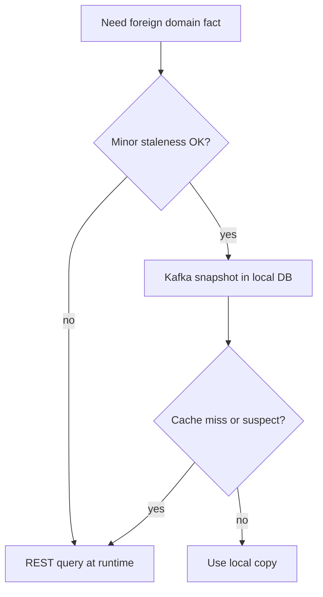
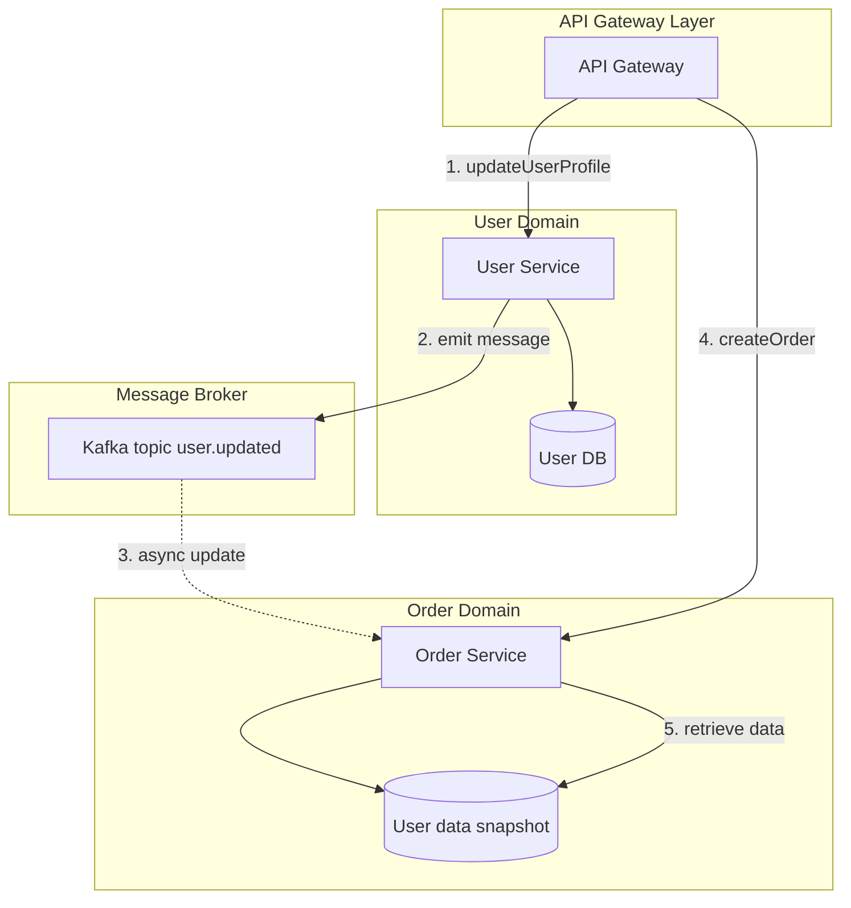
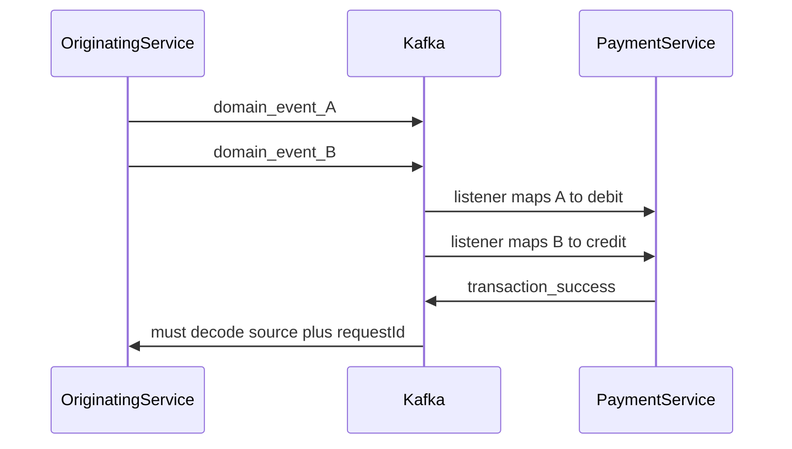
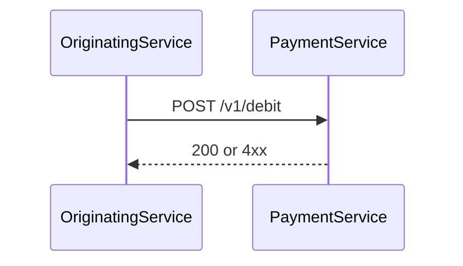
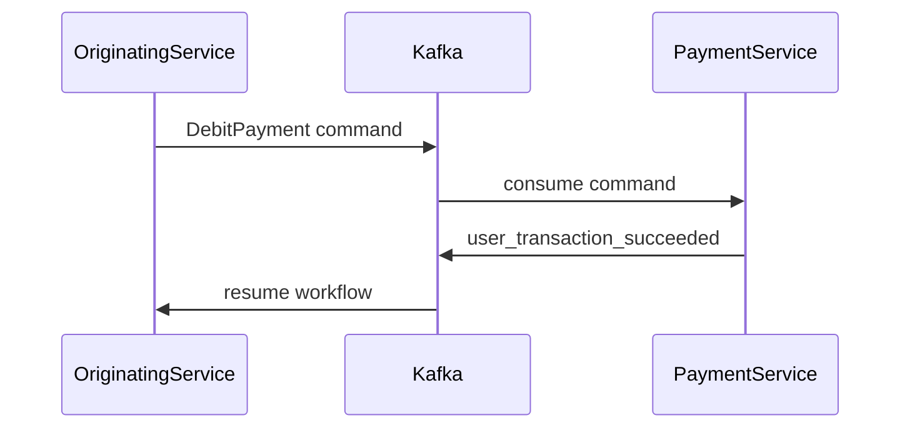

We run a fleet of Nest services on ECS and PM2, with Kafka for domain integration and Firebase at the API gateway. That stack only works if we agree on a few defaults: who owns data, when to use events versus HTTP, how contracts are defined, and where auth stops. This post is our **engineering playbook** for those defaults—not a claim that every service already matches them. Some rules describe **where we want to be** (for example strict one-database-per-service everywhere); others we apply today with known gaps (consumer backoff patterns still being defined).

The post has three parts: **ten foundation principles**, **patterns for crossing domain boundaries** (with Order and User as the running example), and a **payment debit/credit case study** on why implicit event listeners are painful and what explicit commands buy us.

{/* truncate */}

## 1. Each microservice owns its data

**Rule:** one domain, one database. No service reads or writes another service’s store.

If you need someone else’s data, use a **versioned REST call** or subscribe to **Kafka events** and keep a local copy. The only exception we allow is **temporary shared access during a migration** between services—and even then we treat it as debt with an exit date.

## 2. Use Kafka for state changes, not queries

**Rule:** publish when domain state **changes**—`user-created`, `order-placed`, `payment-success`—not when another service needs a **read** or a **real-time decision**.

Kafka is an integration log, not a query engine. Using it to “fetch” user status at decision time turns consumers into brittle RPC clients and couples lag to business logic.

**Sagas** are the intentional exception in shape, not in spirit: a long-running flow may touch several domains and emit **multiple state-change events** along the way. That is still “something happened,” not “give me the current row.”

## 3. Expose a versioned REST API

**Rule:** public and partner-facing HTTP APIs live under **`/v1/...`** (and future `/v2/` when we break compatibility on purpose).

Services at the edge expose REST. **Internal** traffic can be REST or Kafka events, depending on freshness and coupling—we pick deliberately in [§ Crossing domain boundaries](#crossing-domain-boundaries). Versioning at the path keeps gateway routing and client expectations explicit.

## 4. Define clear API contracts

**Rule:** every service ships an **OpenAPI (Swagger)** spec that matches what it actually runs.

Payloads stay **flat and consistent** across services: prefer clear field names and shallow objects over deep nesting that mirrors every join in the database. The spec is the handshake for humans, codegen, and reviews—not documentation we write after the fact.

## 5. Validate contracts

**Rule:** validate **HTTP bodies and event payloads** at the boundary with shared schemas—we standardize on **zod** in Node services.

Parsing once at the edge of the handler (or consumer) gives us **fail fast** behavior (see §6) and keeps invalid messages out of domain code. OpenAPI describes the contract; zod enforces it at runtime. Consumer-driven contract testing (for example Pact) is on our roadmap as a complement, not a replacement for schema validation at the service.

## 6. Fail fast, retry smart

**Rule:** reject bad input and unprocessable state **early** with a clear error. **Retry** only for **transient** failures—network blips, broker hiccups, throttling—not for validation or business rule violations.

Kafka consumers in our stack already retry poison-adjacent cases with operational playbooks; we still need **shared backoff and dead-letter patterns** documented and implemented consistently. That work is deliberate follow-up: the principle is decided; the library conventions are not finished yet.

## 7. Trace everything

**Rule:** one logical operation should be followable across HTTP, Kafka, Lambdas, and long-running workers.

We are standardizing on **[OpenTelemetry](/2026/10/29/open-telemetry)** and W3C `traceparent` propagation. That **supersedes** ad-hoc `x-correlation-id` headers for new work: any hop that understands OTEL continues the same trace. Until every path is instrumented, we may still see correlation IDs in older services; new code should inject and extract trace context on produce/consume and outbox commit.

Application logs go to **Elastic Cloud** as structured JSON. Besides trace and span IDs, we include **Kafka message identifiers** (topic, partition, offset, and our internal message id when present) so on-call can jump from a log line to a broker record without guessing.

## 8. Keep logic close to the domain

**Rule:** services are not thin CRUD wrappers over a table unless the domain truly is that simple.

Where it pays off we use **Domain-Driven Design** building blocks—aggregates, value objects, explicit invariants—so business rules live in the domain layer, not scattered across controllers and ORM callbacks. The goal is code that reads like the business, not like a generic data access layer.

## 9. Avoid shared libraries for business logic

**Rule:** share **infrastructure** helpers (logging wrappers, OTEL bootstrap, HTTP client defaults); do **not** share **domain** rules across services.

A shared “UserValidator” npm package feels convenient until two services need slightly different eligibility rules and you ship a breaking version to everyone. Duplication of domain logic is cheaper than hidden coupling. Copy the pattern, not the rule, when domains diverge.

## 10. Auth at the edge, AuthZ in the service

**Rule:** **authentication** happens at the API gateway or entry point (**Firebase** verifies the token before traffic hits Nest). **Authorization**—roles, ownership, step-up, country eligibility—runs **inside each service** that owns the resource.

That split matches what I documented for Second-Memory in [Why I Chose Third-Party (Firebase) Authentication](/2026/10/10/why-i-chose-third-party-firebase-authentication): Firebase proves identity; our services decide what that identity may do on *this* aggregate. No service should trust another service’s “already authorized” flag without its own check when the resource is theirs.

---

## Crossing domain boundaries

Business rules often need facts from another bounded context. Example: **Order** must confirm **User** is in good standing and in an allowed country before accepting a new order. User owns that data; Order owns the placement rule. How do we bridge the gap?



| Pattern | Freshness | Coupling | When to use |
| --- | --- | --- | --- |
| **A — Cached snapshot (Kafka)** | Eventually consistent (often seconds) | Low; no runtime dependency on User API | Performance matters; minor staleness is acceptable |
| **B — REST query** | Up to date at call time | Higher latency; temporal coupling to User | Real-time accuracy is essential |
| **C — Hybrid** | Usually local; fresh on miss | Medium; fallback path must be tested | Default for many flows: fast path + safety net |

### Option A — Cached snapshot (preferred default)

At runtime, User owns the canonical row; Order keeps a **local user-data snapshot**—only the fields Order needs for placement (for example country, state, status)—fed by Kafka so the placement path never calls User’s HTTP API. Firebase auth runs at the gateway on both the profile write and the order request (see §10).



The numbered edges in the diagram:

1. **updateUserProfile** — The client calls User through the gateway to change profile, status, address, or anything else that affects order eligibility.
2. **emit message** — User writes to **User DB** and publishes a **state-change** event (not a query).
3. **async update** — Order’s consumer upserts the **user-data snapshot** (subset of User fields Order cares about); this path is eventually consistent.
4. **createOrder** — A separate order request hits Order only. Order does **not** call User synchronously on this path.
5. **retrieve data** — Eligibility checks read the **snapshot**, not User Service.

User publishes those changes—for example `user-updated`, `user-status-changed`, or `user-address-changed`—often on a single topic such as `user.updated`. Order subscribes and persists only what it needs in its own database (orders plus the local user snapshot):

```typescript
// OrderService Kafka handler
@KafkaListener('user.updated')
async handleUserUpdate(payload: UserUpdatedEvent) {
  await this.userRepo.saveOrUpdate(payload.userId, {
    country: payload.country,
    state: payload.state,
    status: payload.status,
  });
}
```

Validation for new orders uses that **snapshot**, not a full User record. Fast and decoupled; accept that a brand-new status change may lag briefly behind User. Order must not read User DB or call User HTTP on the placement path under Option A alone—if the snapshot row is missing or too stale, use **Option C (hybrid)** below.

### Option B — REST API call (query pattern)

When the decision must reflect User **right now**, call User at runtime:

```typescript
// OrderService: validateUserForOrder
const user = await this.httpService
  .get(`https://user-service.internal/v1/users/${userId}`)
  .toPromise();

if (user.data.status !== 'good_standing' || user.data.country !== 'AU') {
  throw new ForbiddenException('User is not eligible to place an order');
}
```

Always current; you pay in latency and in **availability coupling**—if User is down, Order cannot complete the rule check unless you have a fallback.

### Option C — Hybrid

Use the snapshot by default; on cache miss or suspicious staleness, call User and optionally refresh the local row (still persisting only the fields Order needs).

```typescript
const user = await this.localUserSnapshotRepo.find(userId);
if (!user) {
  const apiUser = await this.userApiClient.getUser(userId);
  await this.localUserSnapshotRepo.save({
    userId: apiUser.id,
    country: apiUser.country,
    state: apiUser.state,
    status: apiUser.status,
  });
  return apiUser;
}
return user;
```

We use this when the happy path should stay off the critical path of User’s API, but we cannot afford silent wrong decisions on empty cache.

---

## When events are the wrong shape — payment debit and credit

Sometimes integration should be modeled as a **[command](https://event-driven.io/en/whats_the_difference_between_event_and_command/)**—an intention directed at a specific handler—not as a domain event every downstream service must interpret. Payment is our clearest example.

**Payment** debits and credits user balances. Many originating services need those operations. We **used to** model it like this:

- Originating services emit **their** domain events that *implicitly* mean “take money” or “refund money.”
- Payment registers **a listener per event type** and encodes knowledge of each scenario: which event implies debit, how to derive transaction source and request id.
- Payment performs the transaction and emits success or failure events keyed by transaction source and request id.
- Originating services must **implicitly** know that those fields map back to *their* workflow.

That design spreads payment semantics into every producer’s event vocabulary. Payment becomes a central interpreter of foreign languages instead of a service with a narrow, explicit API.



### Alternative — synchronous API commands

Model debit and credit as **well-known HTTP commands** with a stable schema. The caller supplies **transaction source** and **transaction request id**; Payment does not care which feature invoked it.

**Pros:** Payment stays ignorant of callers; immediate success/failure in the response.

**Cons:** **Temporal coupling**—if Payment is down, the caller must retry until it recovers. In an event-first codebase that often means: emit a local event, handle it in a listener, and loop retries from there—more moving parts than a direct call with idempotency keys.



### Alternative — asynchronous commands

Publish commands to a **well-known Kafka topic** Payment owns. Callers produce `DebitPayment` / `CreditPayment` messages; Payment consumes and executes. No synchronous response—outcomes appear as **domain events** Payment already owns, for example `user-transaction-succeeded` / `user-transaction-failed`, which callers subscribe to if they need completion.

**Pros:** Same decoupling as explicit API (Payment does not know the caller’s event names); **no** temporal coupling on the produce path; callers choose their own correlation ids.

**Cons:** No immediate feedback; originating workflows must be **saga-shaped**—listen for outcome events or poll a read model. That aligns with how we already name work on the Event Modeling board ([From Event Modeling to a Kafka Saga](/2026/10/26/from-event-modeling-to-a-kafka-saga)): `Payment.debitPayment` as a command with `payment_success` / `payment_failure` as outcomes, rather than Payment guessing from unrelated domain events.



We are not flipping every flow overnight. The direction is clear: **local snapshots and explicit commands** beat **REST spaghetti** and **payment listeners that speak every team’s event dialect**. Events stay for **things that happened**; commands carry **work we want Payment to do**; REST fills the gaps when freshness beats cache.

> **Prefer a denormalized read model fed by Kafka when staleness is acceptable; prefer explicit payment commands over payment inferring debits from someone else’s domain events; use REST when the decision must be correct to the second—and document which choice you made.**
