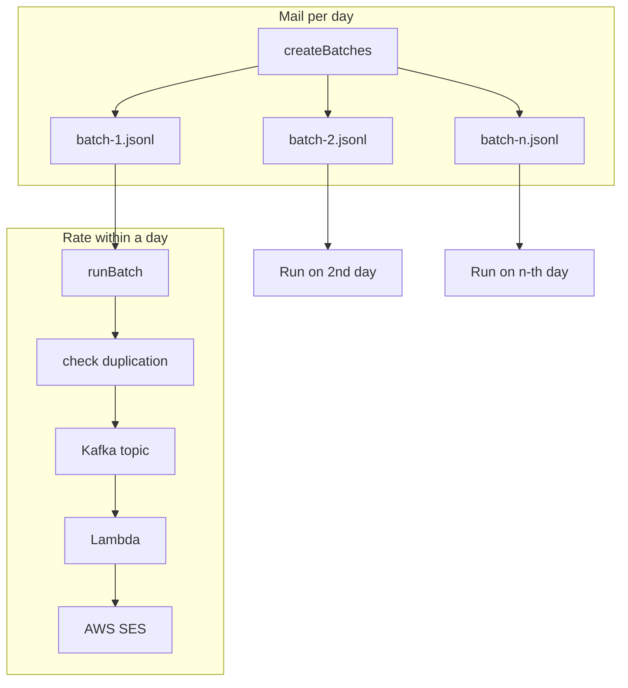

Large-scale reminder campaigns needed to reach a large eligible audience without a single-day blast that would spike SES throttling, bounces, and complaints. Reputation here was mostly an operations problem: control **how much mail leaves per day** and **how fast it hits SES**, then watch Virtual Deliverability Manager (VDM) while sending.

The code does not score reputation. It paces volume, targets an average send rate within each batch, deduplicates by send date, and filters eligibility in SQL. Below: the two guardrails, how `createBatches` and `runBatch` enforce them, and the path through Kafka and the messenger Lambda to the messaging API and SES.

{/* truncate */}

## Architecture overview



`createBatches` can produce many JSONL files; cron runs **`runBatch` once per day**, drains the next pending file, then follows the same send path (check duplication, Kafka, Lambda, SES). Later files run on later cron days—the labels are shorthand for that schedule, not separate pipelines.

The automation path is `npm run createBatches -- --email-id <campaign>` ahead of send windows, then a daily cron `npm run runBatch`. The same emit logic also supports a direct `emitBulkEmails --input` JSONL workflow without the `email_reminder_automation_batches` table.

## 1. Reputation guardrail — how much mail per day

A sudden jump from zero to millions of messages in one day is what SES and mailbox providers notice. We spread work across **calendar days** by splitting recipients into batch files and draining **at most one pending batch per cron run**.

| Knob | Role |
| --- | --- |
| `batchSize` in `configuration.json` | Max recipients per `batch-{n}.jsonl`; one row in `email_reminder_automation_batches` per file |
| `eligible-user.sql` | Who gets mail; stable `ORDER BY` for reproducible splits |
| `{emailId}/{YYYY-MM-DD}/batch-{n}.jsonl` | On-disk snapshot for a send date (UTC at create time) |
| `email_reminder_automation_batches` | `pending` → `processing` → `completed` or `failed` |

**createBatches** loads config and SQL, snapshots eligible users into a MySQL temp table so paging is stable while export runs, then writes JSONL in chunks of `batchSize` and inserts a `pending` row per file. One run can create several files: for example, 2M users with `batchSize: 500000` yields four files and four pending rows—four cron days of work at one batch per day.

**runBatch** selects the first pending row (`ORDER BY send_date_key, batch_number LIMIT 1`), marks it `processing`, runs the bulk emit script on that file, then `completed` or `failed`. Production cron runs daily (`0 1 * * *` UTC) with `flock` so only one batch drains per day. That is how “500K per day” is enforced: operational schedule, not an in-process daily cap inside the emitter.

Layout on disk:

```text
{emailId}/                          e.g. monthly-reminder
├── configuration.json
├── eligible-user.sql
└── 2026-10-01/
    ├── batch-1.jsonl
    └── batch-2.jsonl
```

Example JSONL line:

```json
{
  "id": "…",
  "email": "user@example.com",
  "reminderData": {
    "firstName": "Alex",
    "gameKey": "fortnite"
  }
}
```

## 2. Reputation guardrail — how fast mail hits SES within a day

While a batch file is emitting, the goal is to keep **average** recipient throughput near an approved target and stay under the account SES `MaxSendRate`. Bursts into the shared messaging SMTP path cause throttling and noisy delivery patterns.

| Knob | Role |
| --- | --- |
| `maxSendRatePerSecond` | Target **average** recipients per second; used to compute `minMessageDurationMs` on each Kafka payload (not a hard per-second token bucket by itself) |
| `emailsPerKafkaMessage` | Recipients bundled per Kafka message; `runBatch` passes this as emit `batchSize` |
| `minMessageDurationMs` | Producer-set floor on wall time per message; the Lambda waits any **remaining** time after messaging sends complete |

For each Kafka record, the producer computes:

```text
minMessageDurationMs = ceil(recipientCount * partitionKeyShards * 1000 / maxSendRatePerSecond)
```

Tune **`maxSendRatePerSecond`** and **`emailsPerKafkaMessage`** for reputation and quota. `partitionKeyShards` appears in `configuration.json` so the duration math matches deployed consumer parallelism.

**Consumer pacing:** The `on-email-bulk-send` Lambda consumes the `email-bulk-send` topic with MSK `batchSize: 1` (one Kafka record per invocation). It calls the messaging API to send, then applies a minimum message duration wait in a `finally` block. If SES still complains, operator docs point at lowering `maxSendRatePerSecond`, `emailsPerKafkaMessage`, or the messenger env var for per-recipient concurrency inside one invocation—not Kafka key count.

Example with campaign-style settings (`maxSendRatePerSecond: 20`, `emailsPerKafkaMessage: 10`, `partitionKeyShards: 2` in config only for the formula): `ceil(10 × 2 × 1000 / 20) = 1000` ms minimum per message, i.e. roughly 20 recipients per second on average across active consumers.

**Resume and dedup:** Send state keys `{ sendDateKey, userId }` (the recipient `id` from the batch file). The producer skips users already sent for that date; re-run the same `sendDateKey` after an interrupt. Do not change `sendDateKey` when resuming or users can receive the same reminder twice.

**Monitoring:** Script pauses for VDM review during large direct sends; watch SES configuration-set metrics, bounces, and complaints. The system paces and observes—it does not auto-adjust reputation.

## Pipeline walkthrough

### Create batch

Inputs:

- `configuration.json` — template, query path, `batchSize`, rate fields (see configuration reference).
- `eligible-user.sql` — who is eligible. Supports `${emailId}` and `${sendDateKey}` placeholders.

Outputs:

- JSONL under `{emailId}/{sendDateKey}/batch-{n}.jsonl`.
- One `pending` insert per file in `email_reminder_automation_batches` (`email_id`, `send_date_key`, `batch_number`, `status`, `when_completed`).

### Run batch and publish

1. Fetch first `pending` batch row.
2. Resolve `batch-{batchNumber}.jsonl`; fail the row if the file is missing.
3. The emit script reads the file, checks duplication against send state, publishes to Kafka.

Headers include `message-type` (template id, e.g. `monthly-reminder`) and `message-id` (`{sendDateKey}-batch-{batchStartIndex}`). Body includes `emailTemplate`, `recipients`, and `minMessageDurationMs`.

```json
{
  "emailTemplate": "monthly-reminder",
  "minMessageDurationMs": 1000,
  "recipients": [
    {
      "userId": "…",
      "email": "user@example.com",
      "reminderData": {
        "firstName": "Alex",
        "gameKey": "fortnite"
      }
    }
  ]
}
```

### Consume and send

`on-email-bulk-send` dispatches by `message-type`, validates the payload, calls messaging, and delivers through SES (configuration set and message tags on the SMTP path). Pacing is described in section 2.

## Configuration reference

| Field | Reputation-facing? | Notes |
| --- | --- | --- |
| `emailTemplate` | — | Messaging template name |
| `query` | Hygiene | Path to `eligible-user.sql` |
| `batchSize` | **Daily volume** | Recipients per JSONL file |
| `maxSendRatePerSecond` | **Intraday rate** | Average target; drives `minMessageDurationMs` |
| `emailsPerKafkaMessage` | **Intraday rate** | Bundle size per Kafka message |
| `partitionKeyShards` | Fixed in JSON | Used in duration formula only |

**Campaign automation** (e.g. monthly reminder): large `batchSize` (500000), `maxSendRatePerSecond: 20`, modest `emailsPerKafkaMessage`.

```json
{
  "emailTemplate": "monthly-reminder",
  "query": "./eligible-user.sql",
  "batchSize": 500000,
  "partitionKeyShards": 2,
  "emailsPerKafkaMessage": 10,
  "maxSendRatePerSecond": 20
}
```

**Direct emit / throughput test** (operator README): smaller per-message bundles and higher target rate, e.g. `--batch-size 14` and `--max-send-rate-per-second 70` against an exported JSONL—same Kafka pacing math, without the batch table queue.

## Operations and observability

| Concern | Where to look |
| --- | --- |
| Batch queue | `email_reminder_automation_batches.status`, `when_completed` |
| Producer progress | Emit script logs (processed / successful / failed / skipped) |
| Consumer errors | CloudWatch for `on-email-bulk-send-<env>` |
| SES health | VDM, configuration set metrics, suppression list |
| Send state | By `sendDateKey` and user id |
| Stuck sends | Pending batches with missing JSONL; SES throttling vs `maxSendRatePerSecond` |

## Summary

Reputation for this system boils down to two operational guardrails: **emails per day** (`batchSize` + daily `runBatch`) and **send rate within a day** (`maxSendRatePerSecond`, `emailsPerKafkaMessage`, Lambda `minMessageDurationMs`, plus SES quota and VDM). Everything else—Kafka, send-state dedup, SQL eligibility—implements those limits so a large reminder campaign does not become a single spike in the eyes of SES or recipients.
