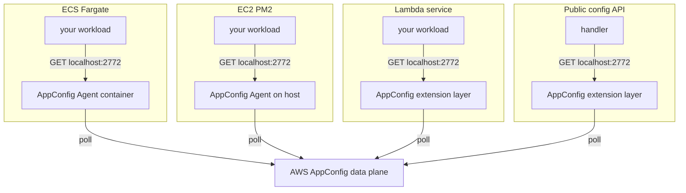
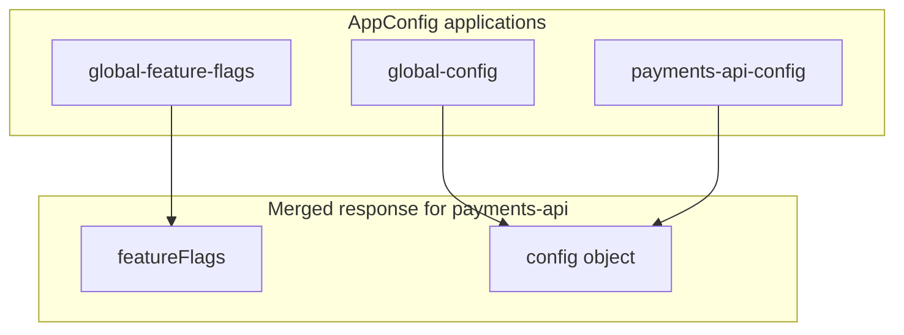

We centralized feature flags and service configuration in **AWS AppConfig** instead of a monolith flag store and S3 env files baked in by CI/CD. **Amazon’s AppConfig Agent or extension** delivers settings on **`localhost:2772`**; backend services use one **shared library** with the same read pattern on every stack. Fictional examples: `payments-api`, `client-app`, flag `enable_new_checkout_flow`.

{/* truncate */}

This post covers generic flags and configuration, **AWS AppConfig** and delivery on port 2772, how we layout and merge profiles for services, and local development against a mock.

## Feature flags and configuration

Feature flags and configuration answer different questions. Teams usually store them separately, but services often need both at runtime. Shipping safely means knowing which is which before you wire a new key.

| | Feature flags | Configuration |
| --- | --- | --- |
| **Purpose** | Turn behavior on/off; optional **attributes** for sub-toggles | Strings, numbers, URLs—settings with more than two states |
| **Shape** | Named flags with an `enabled` switch (and optional fields) | Key–value (or structured) settings per service or environment |
| **When to use** | Gate code paths (web, mobile, microservices) | Connection strings, feature thresholds, UI copy, service knobs |
| **Typical change** | Flip a boolean or attribute without redeploying (if you read at runtime) | Adjust a value; may still require deploy if config is baked at build time |

### How we did before

Flags lived in a central database behind a PHP monolith and cache; Lambdas, ECS, and mobile often called a monolith HTTP API. Configuration was a **`.env` on disk** on laptops; in AWS, **CI/CD** pulled env files from **S3** into task definitions or instances at deploy time.

| Area | Before |
| --- | --- |
| Feature flags | Central DB + cache behind the monolith |
| Application config | `.env` locally; S3 env file wired in by CI/CD at deploy |

That split hurt in a growing fleet: no shared flag source without the monolith, weak audit on config changes, and many knob turns required redeploy or restart. What follows is the centralized store and delivery model we use today, and how services read configuration from it.

## AWS AppConfig

**AWS AppConfig** is the managed store we use for both feature flags and configuration. In our setup it replaces the monolith flag database and the S3 env file pattern with versioned definitions and explicit deployment to each environment.

- **What it provides** — Hosted configuration and feature flags, validators on config, version history, and **per-environment deployment** (a console edit is not live until you deploy that version).
- **Why it fit** — One audit-friendly place for flags and config; services can read at runtime instead of redeploying for every toggle, when they use the delivery path below.
- **How objects nest** — An **application** (for example `global-feature-flags` or `payments-api-config`) contains **environments** (`dev`, `qa`, `prod`) and **configuration profiles** (for example `feature-flags`, `private-config`). The layout we provision is spelled out in the next major section.
- **How runtimes reach it** — Our workloads do not embed AppConfig API clients. **AppConfig Agent** on ECS and EC2 and the **AppConfig extension** on Lambda cache configuration locally, poll the **data plane**, and expose **`localhost:2772`** inside the process network.

Feature flags use AppConfig’s feature-flag profile type; other settings use freeform JSON with schema validation at deploy time (details in the layout section below).

### Agent and extension on `localhost:2772`

On each stack, the listener on **port 2772** is **published by AWS**. Application processes issue HTTP **GET** requests on localhost; they do not implement polling or sync to AppConfig themselves.

| Stack | Component on 2772 |
| --- | --- |
| **ECS Fargate** | **AppConfig Agent** container image (`public.ecr.aws/aws-appconfig/aws-appconfig-agent:2.x`) in the task |
| **EC2 / PM2** | **AppConfig Agent** on the host (e.g. installed from RPM on the AMI) |
| **Lambda** | **AppConfig extension** layer (`AWS-AppConfig-Extension`) in the execution environment |
| **Public config Lambda** | Same **extension** pattern; mobile and web clients have no agent on the device |

Every stack uses the same URL pattern:

`http://localhost:2772/applications/<application>/environments/<env>/configurations/<profile>`

The workload GETs that URL; the agent or extension returns its in-memory cache. [Agent overview](https://docs.aws.amazon.com/appconfig/latest/userguide/appconfig-agent.html) and [Lambda extensions](https://docs.aws.amazon.com/appconfig/latest/userguide/appconfig-integration-lambda-extensions.html) cover polling intervals and tuning (for example `AWS_APPCONFIG_EXTENSION_POLL_INTERVAL_SECONDS` on Lambda).

**Deploy, poll, and application cache** are three different clocks. A configuration edit in the console does not affect the data plane until you **deploy** that version to an environment. After deploy, the agent or extension **refreshes on its poll interval** (often on the order of 45 seconds). Even an up-to-date agent cannot help if the application read flags once at boot and never asked again.

Config read **at build time**—for example when generating a task definition or `.env` file—**bakes** values into artifacts; changing AppConfig still requires redeploying those artifacts for those keys. **Run-time** GETs to 2772 can pick up flag changes without a new image, as long as deploy, poll, and re-read behavior align. IAM on the task or instance role allows the AWS listener to reach AppConfig; your process only talks to localhost.

When a flag change does not show up, confirm deployment finished for the right environment, allow time for the agent or extension to poll, and check whether the service re-fetches flags after startup.

## How services consume AppConfig

As sketched above, an **infrastructure repository** (CDK) provisions AppConfig applications, environments, profiles, and a **public HTTPS config API** per account and environment. The layout is **centralized flags, federated per-app config**.

We use one **shared library** on ECS, EC2, Lambda, and local mock: same localhost contract on every stack, independent of which agent or extension sits on 2772. It does not poll AppConfig or replace those AWS components.

| AppConfig application | Profiles | Role |
| --- | --- | --- |
| `global-feature-flags` | `feature-flags` | Shared flag namespace |
| `global-config` | `public-config`, `private-config` | Defaults for every app |
| `payments-api-config` | `public-config` / `private-config` (if defined) | Service-specific overrides |
| `client-app-config` | Often `public-config` only | Mobile/web-facing settings |

The **app registry** describes allowed keys per logical app; infrastructure turns those definitions into JSON Schema validators on each profile. Registering a **new service** means a registry entry and a deploy; registering a **new flag** updates the canonical flag definition without touching every app entry.

### How profiles merge when you read them

Which profiles exist is a layout concern; **who merges what** depends on the caller.

For a service such as `payments-api`:

- **Flags** come only from the global feature-flag application and profile—not from per-app config.
- **Config** is a **shallow merge**: global defaults, then service-specific overrides; the app wins on key clashes. A missing app profile is treated as empty.
- **Public vs private** profiles control which HTTP API may return them—not a second merge algorithm. Private values must not appear on the mobile-facing route.

Two consumption patterns sit on top of that layout:

- **Mobile and web** call a **public config Lambda** behind API Gateway. That component reads through 2772 and returns one JSON object `{ featureFlags, config }` suited to clients.
- **Backend services** use the shared library with **two read patterns**: the **shared flag namespace** only (no other apps’ config), and **this app’s config only** (global private defaults plus that app’s private profile—never another service’s profiles). The library does not assemble flags and config into one in-process payload the way the public API does.

Environment names in URLs must match the AppConfig **environment** the workload runs in (`dev`, `qa`, `prod`, …).

## Local development

The infrastructure repo runs a **mock listener** on **2772** so laptops hit the same URL shapes as production. A lightweight **public API on 2773** stands in for the mobile route during quick tests.

The same shared library and URL contract apply on a laptop: only the process behind 2772 is a fixture instead of the AppConfig Agent container, host agent, or extension.

Edit a **local overrides file** to flip flags and attributes; you do not need to restart services for those fixture updates. Example:

`http://localhost:2772/applications/global-feature-flags/environments/dev/configurations/feature-flags`

## Caveats

Migration is incremental: older flag and env patterns still appear on some services. AWS supports multi-variant flags; our deployment tooling focuses on booleans and boolean attributes.

The **public config Lambda** and backend services both read through 2772, but only the public API merges `{ featureFlags, config }` for HTTP clients; the shared library keeps flags and per-service config as separate reads for in-process use.

## References

- [What is AWS AppConfig Agent?](https://docs.aws.amazon.com/appconfig/latest/userguide/appconfig-agent.html)
- [Creating a feature flag configuration profile](https://docs.aws.amazon.com/appconfig/latest/userguide/appconfig-creating-configuration-and-profile-feature-flags.html)
- [AppConfig on EC2](https://docs.aws.amazon.com/appconfig/latest/userguide/appconfig-integration-ec2.html)
- [AppConfig Lambda extensions](https://docs.aws.amazon.com/appconfig/latest/userguide/appconfig-integration-lambda-extensions.html)
