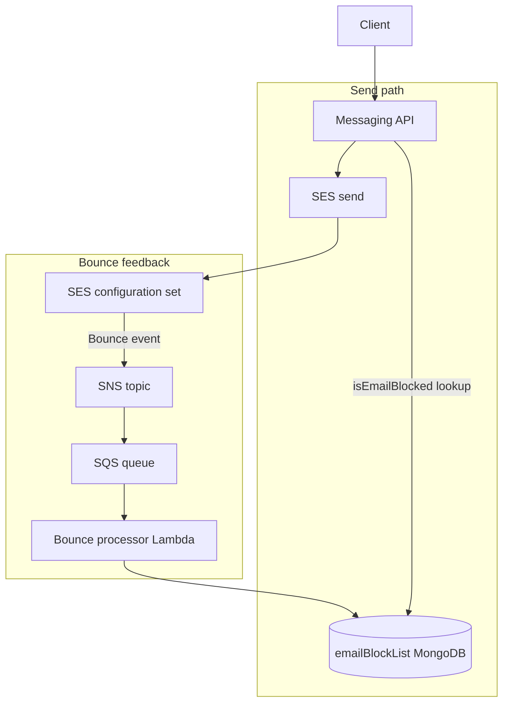

Sending at scale does not stop when mail leaves Simple Email Service. **Permanent bounces** hurt reputation and waste work if those addresses stay in eligibility lists. The goal is to capture bounce feedback, keep a durable block list, and **refuse sends at the messaging API** before traffic reaches SMTP or SES again.

The send path already lived in a **JavaScript service on EC2** (PM2, CodeDeploy). That stack is fine for GraphQL and SMTP, but a poor home for a **long-lived queue consumer**. The design adds event-driven components alongside messaging: configuration set, SNS, SQS, a bounce processor Lambda, and a shared Mongo collection the API reads on every send.

{/* truncate */}

## Architecture overview

Outbound mail uses a **SES configuration set** so bounces become events. Those events publish to **SNS**, land in **SQS**, and a **Lambda** upserts blocked addresses into **`emailBlockList`** in MongoDB—the same database the messaging service already uses. On the next send attempt, the API looks up the recipient email in that collection and stops before calling SES.

## Runtime behavior

| Step | What happens |
| --- | --- |
| SES | Bounce notification on the configuration set → SNS topic. |
| SNS → SQS | Topic fans bounce payloads into a queue (buffer and decouple from Lambda). |
| SQS → Lambda | Lambda consumes records, parses the SES bounce JSON; no EC2 consumer on the messaging fleet. |
| Persist | Upsert by **email** into `emailBlockList` (store `feedbackId` and the raw event for debugging). |
| Guard | Before send, messaging checks the collection; blocked users get **`EMAIL_BLOCKED`** on the API response. |
| Scope | **Permanent** bounces are what we persist for blocking; transient bounces are not auto-blocked. |

Each stored row is keyed by email. Replays or duplicate events update the same document rather than multiplying rows. The guard is read-only from messaging’s perspective: the bounce processor **writes**; resolvers and the emailer **read**.

## Architectural decisions

Two decisions framed how we built this without folding bounce handling into the existing Node deployment.

### Lambda instead of an EC2 consumer

We needed something to **consume SQS** (fed by SNS) for bounce processing. The alternative was the AWS SDK inside the same Node application on EC2 or Docker—another PM2 worker polling the queue.

We chose **Lambda**. Long-running consumers on the messaging hosts add operational noise: visibility timeouts, scale-out of the fleet, and coupling bounce deploys to CodeDeploy. Lambda keeps bounce processing off the send path machines.

### Dedicated repo, shared database

We needed **CDK** for SNS, SQS, Lambda, and a TypeScript handler. Options included putting CDK and the consumer inside the messaging repo, a CDK-only repo with bounce logic still in PM2, or piggybacking on the bulk-send Lambda repository.

We chose a **separate repository** for infrastructure and the bounce processor, with **Mongo shared** between messaging (owner of the schema for day-to-day sends) and the Lambda (writer to `emailBlockList`). That bought a fast TypeScript/CDK slice and a simple deploy story without mixing JavaScript and TypeScript builds in one CodeDeploy unit.

The accepted cost is **two repos, one database**: migrations and ownership of `emailBlockList` need a clear line—messaging defines how sends behave; the processor only upserts bounce-driven blocks.

## What we actually built — no SQS

The diagram and sections above follow the **component picture from the design doc** (SNS, SQS, Lambda, database). In production we **did not provision SQS**. The CDK stack wires the bounce SNS topic to the handler with a **direct Lambda subscription**—SES bounce events still hit SNS; the processor runs as a Lambda triggered from that topic instead of from a queue.

We dropped the queue because the action per event is small: parse the SES JSON, validate a **permanent** bounce, **upsert one email** in Mongo. There is no multi-step saga and little fan-out. Bounce volume is typically **tiny next to send volume**, so a buffer queue did not buy much operational leverage.

What we give up without SQS: queue depth as a backlog signal, and the usual poison-message loop (DLQ after max receives). For this handler, **Lambda errors and duration in CloudWatch** plus SES/SNS metrics were enough. SQS still makes sense when processing is slow, bursty, or must sit in a queue for hours—we did not need that here.

The handler still behaves like the runtime table describes: upsert by email, permanent bounces only, same `emailBlockList` the API consults before send.

## Operations and observability

- **Lambda:** errors, duration, throttles in CloudWatch (standard function log group).
- **SES / SNS:** bounce rate against send volume; configuration set event delivery.
- **Messaging:** count of **`EMAIL_BLOCKED`** responses versus successful sends—feedback on whether the block list is catching bad addresses after campaigns.

## Summary

Bounce handling is a closed loop: **events write blocks, the send path reads blocks**. SNS, SQS, and Lambda keep bounce work off EC2; a dedicated repo keeps it off the messaging deploy train. List hygiene on the way out and block-list enforcement on the way back in protect reputation together—not either one alone.
