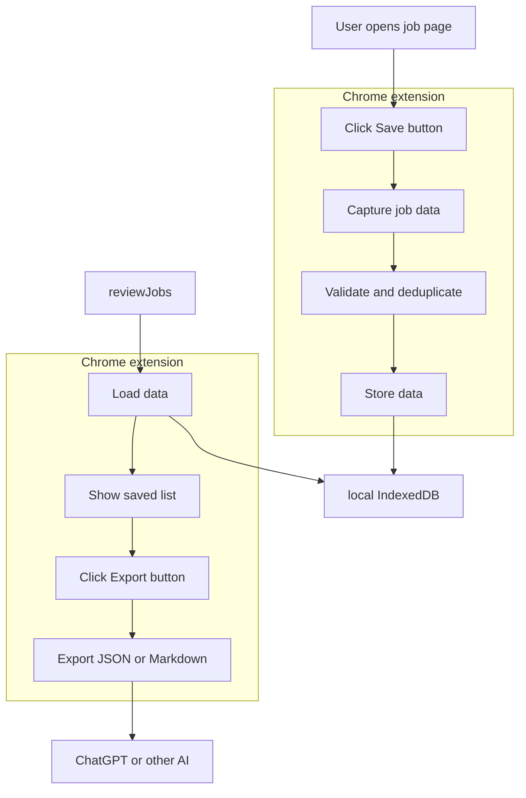
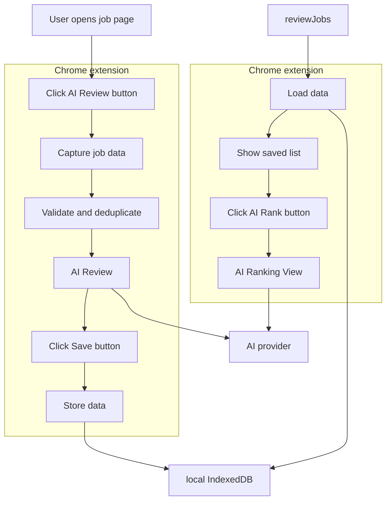

Job searching takes time, especially when the goal is the right role rather than applying everywhere. Lately I've been on SEEK and LinkedIn almost daily, and the same steps repeat: save jobs, then copy descriptions into an AI chatbot so I can compare them against my background.

The goal is not to auto-apply to hundreds of listings. It is to **spend less time managing listings and more time on applications that matter**. This post is about a Chrome extension idea: collect and organise job descriptions locally, then use AI the way I already do in my workflow—without the copy-paste loop.

{/* truncate */}

## My current job search workflow

My routine looks like this:

1. Search SEEK and LinkedIn using keywords and filters.
2. Skim results and save promising jobs.
3. Open the saved-jobs list when I'm done searching.
4. Copy each description into an AI chatbot.
5. Ask the AI to rank jobs against my experience and preferences.
6. Review and apply where it makes sense.

AI already helps with comparison and trade-offs. **Getting descriptions into the chatbot is still manual**: open job, copy, paste, repeat. That is what I want the extension to fix.

## What should still be manual—and why?

At first I wondered whether the whole pipeline could be automated, from searching to submitting applications. Breaking it down, most steps should stay manual—not because automation is impossible in theory, but because **I want them that way**, and because **job platforms do not allow** the kind of unattended scraping or auto-application bots that would replace them.

| Step | Approach | Why |
|---|---|---|
| Search for jobs | Manual (or existing alerts) | I choose keywords, filters, and timing; platforms expect a human browsing experience. |
| Skim search results | Manual | Judgement call on fit, tone of the ad, and whether the company is worth a closer look. |
| Select interesting jobs | Manual | Only I know what I will tolerate on team, stack, and seniority. |
| Capture job descriptions | Extension (user-initiated) | Repetitive, but only after I open a listing—not a background crawler. |
| Save and organise jobs | Extension | Tedious tracking and deduplication; safe to automate locally. |
| Rank jobs | AI-assisted | Useful comparison, but I still interpret the output. |
| Decide which jobs to apply for | Manual | Final call stays mine. |
| Prepare applications | AI-assisted (optional) | Drafting help; I edit and own what gets sent. |
| Submit applications | Manual | Platforms forbid automated submission; applications should be deliberate. |

SEEK, LinkedIn, and most career sites restrict automated access, bulk extraction, and scripted logins even when the user is “helped” by a tool. Extensions that ignore that risk account bans and ToS trouble. So capture happens **only after an explicit action** on a page I am already viewing, and when extraction fails or is not permitted, **paste or selected text** is the fallback—not a silent scrape across my saved list.

What I want the product to optimise is simple: **Open a job listing → click Save → review everything I collected later.** Title, company, URL, location, salary when visible, full description where allowed—stored locally and deduplicated. The extension fills the gap between “I picked this job” and “I am ready to compare or apply,” without taking search, judgement, or submit away from me.

## Why a Chrome extension?

A standalone web app with backend and database would work, but infrastructure comes before the real problem. The friction is in the browser, on the job sites I already use.

An extension can act after an explicit user gesture, capture what is permitted, and persist to **local IndexedDB** without a service I have to run. The save-then-export flow for Manual mode is diagrammed under [Manual mode](#manual-mode) below.

For an initial version I do not need a cloud backend. Saved jobs and profiles can stay in the user's browser. I may publish to the Chrome Web Store or ship builds from a public repository.

## AI integration modes

How AI fits in is one of the main design choices. Different users already have different setups: some pay for ChatGPT or Claude in the browser, others are comfortable with an API key, others want neither. I am not treating that as a strict v1 → v2 → v3 roadmap—**modes can coexist as choices**—but **what I am most likely to build is Manual first, then BYOK** if the daily workflow still feels worth streamlining. A hosted path is a separate decision after those two are proven in real use.

### Manual mode

Manual mode is the simplest integration and the one I expect to ship first. The extension collects and organises; **AI stays in the chatbot you already use.**

The diagram shows two passes through the extension, with **local IndexedDB** in the middle.

**While browsing**

1. **Open a job page** on SEEK, LinkedIn, or a career site.
2. In the extension: **Save** → capture job data → validate and deduplicate → **store** → **IndexedDB** (paste or selection still applies when a site limits extraction). Repeat for the next job.

**When you are ready to compare**

3. Open the extension again: **load** from IndexedDB → **show the saved list** → **Export** → **JSON or Markdown**.
4. Use **ChatGPT or another AI** with that file (copy-paste or upload, depending on what you use). Ranking and discussion stay in the chat product—not inside the extension.

**Outside the extension**

- No API calls from the add-on; **no API key**, no provider lock-in, no token billing inside the tool.
- Ranking, reasoning, and follow-up questions happen in the chat product you subscribe to.

That trade-off is deliberate: Manual mode removes copy-paste **per job** and gives you one export from the saved list, even though AI still runs outside the add-on. For subscription users who do not want credentials in an extension—and for a first release built around IndexedDB, a saved list, and export—that is often enough.

If BYOK or another mode appears later, Manual mode should remain the zero-credential, maximum-control option.

### Bring Your Own Key (BYOK) mode

If collection and export help but the export-and-paste step remains annoying every evening, **BYOK is the next experiment worth considering.**

The user supplies an API key in extension settings. The extension still keeps jobs in **local IndexedDB**, but calls the **AI provider** from inside the UI at two explicit points—**AI Review** on a job page and **AI Rank** from the saved list—instead of exporting to a chat tab.

**On a job page**, the flow is **AI Review** (not Save first): capture and validate the listing, show **AI Review** with help from the provider, then **Save** into IndexedDB. **When reviewing your collection**, the extension loads the saved list, you use **AI Rank**, and the **AI Ranking** view calls the provider again—no JSON or Markdown export step in between.

That keeps comparison inside the extension: **no manual export**, and **no backend I operate**; each user pays their own API usage.

The cost is security and trust. A browser extension cannot guard an API key as well as a server. I would treat BYOK as optional, default to **session-only** key storage where the platform allows it, keep keys out of content scripts and ordinary web pages, and document the risk if someone chooses to persist a key. **Manual export** stays available for anyone who prefers ChatGPT or Claude in a separate tab.

I might add BYOK only after Manual mode is in daily use and the friction is real—not as a day-one requirement.

### Managed AI mode

Some users may not have an API key and may not want to configure one. A later option could be a small cloud backend that calls the model with **my** API key. Whether job and career data stay in the browser or in the cloud is **not decided yet**. I would only explore this after seeing how Manual and BYOK work in real use.

## Security and privacy for a public extension

If the repo and extension are public, they need to be trustworthy—not just a personal shortcut.

- Request only minimum browser permissions.
- Capture jobs only after an explicit user action.
- Keep job data and profiles in local browser storage initially; avoid analytics and telemetry at first.
- Never collect cookies or site authentication tokens.
- Treat job descriptions as untrusted content; do not run code embedded in listings.
- Make **export** (Manual) and **AI Review / AI Rank** (BYOK) explicit user actions.
- Never commit API keys or personal profiles to the repository.

Local-first limits what I must store on servers. Browser storage is not a vault; any in-extension or BYOK flow sends selected data to external AI. Job text can also carry prompt-injection-style noise—data to analyse, not instructions to obey.

## Final thoughts

This started with copying descriptions from SEEK and LinkedIn into a chatbot. The broader question is how to use AI for better job-search decisions **without** giving up control—no agent that sprays applications everywhere.

A local-first extension to collect and organise jobs is the small first step. **Less copy-paste, a cleaner saved list, and more time on the applications that count.** I plan to open-source it so others can use and inspect it. In-extension AI, if it happens, would probably start with export (Manual) and only then BYOK; anything hosted depends on whether those paths are enough.
